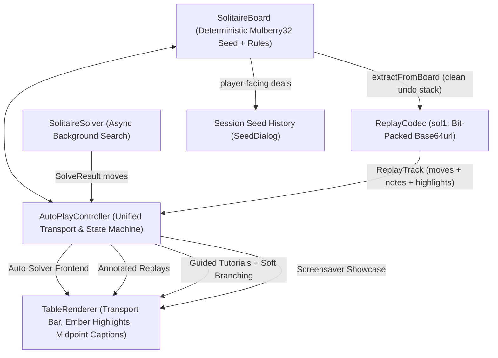

# SolEngine Auto-Play, Replay, Tutorial & Screensaver Pipeline

SolEngine unifies **four player-facing features** — **Auto-Solver**, **Gameplay Replays**, **Interactive Guided Tutorials**, and **Screensaver Mode** — onto a single deterministic playback stack built around `SolitaireBoard`, `SolitaireSolver`, `ReplayTrack`, and `AutoPlayController`.

Because every deal, rule execution, and procedural asset in SolEngine is cross-platform deterministic, a single compact `(gameId, seed, moves, notes)` representation replays identically across **Windows, macOS, Linux, Web/WASM, iOS, and Android**.

---

## 1. Unified Architecture



### Core Source Files
* **Unified Deterministic PRNG & Seed Generator:** `include/solengine/deterministic_rng.hpp`
* **Deterministic Board & Scripts:** `src/game/solitaire_board.cpp`, `src/game/script_rule_engine.cpp`, `src/eatscript/evaluator.cpp`, `src/render/lowpoly_deck_generator.cpp`
* **Solver:** `include/solengine/solitaire_solver.hpp`, `src/game/solitaire_solver.cpp`
* **Replay & Tutorial Format:** `include/solengine/replay_track.hpp`, `src/game/replay_track.cpp`
* **Unified Playback Controller:** `include/solengine/auto_play_controller.hpp`, `src/game/auto_play_controller.cpp`
* **UI, Captions, Highlights & Screensaver:** `src/render/table_renderer.cpp`, `include/solengine/ui/seed_dialog.hpp`, `src/ui/seed_dialog.cpp`

---

## 2. Cross-Platform Deterministic Seeding Foundation

Replays, tutorials, and shared seeds rely on bit-identical determinism across MSVC (`msvcstl`), Linux (`libstdc++`), and macOS/iOS/Android/Emscripten (`libc++`):

* **Deal Shuffling & Gameplay RNG:** `SolitaireBoard::nextRandom()`, `ScriptRuleEngine::rand_int`, `shuffle_zone`, and `math.random` all use fixed-width `uint32_t` **Mulberry32** with manual Fisher–Yates shuffling (avoiding `std::shuffle` and `std::uniform_*_distribution`, whose algorithms vary across C++ standard libraries).
* **Procedural Deck Art (`lowPolySeed`):** `lowpoly_deck_generator.cpp` uses the same `uint32_t` Mulberry32 generator with manual 24-bit float and modulo integer scaling, so shared deck seeds render identically on every platform.
* **Session Seed History:** `SeedDialog` maintains an in-memory session history (up to 64 deduplicated `(seed, gameId, gameName)` entries) covering every player-facing deal and `RANDOM` roll, while excluding internal solver probes and screensaver deals. Clicking a history row loads its seed and game into the dialog; clicking **`PLAY`** immediately switches to that exact game and seed.

---

## 3. The Four Unified Use Cases

### A. Auto-Solver Frontend (`AutoPlayController::start` / `startDemo`)
* **Background Search:** Runs `SolitaireSolver::solve(...)` on a worker thread (or bounded synchronous budget on single-threaded WASM) while keeping the UI responsive.
* **Full Bidirectional History:** Extracts any moves the player already made (`extractBoardHistory`) and stitches them before the solver's remaining solution, allowing full **Rewind**, **Step Back**, **Play/Pause**, **Step Forward**, **Speed Toggle (`1x` / `2x` / `4x`)**, and **Restart**.
* **Instant Take-Over:** Clicking anywhere on the board (or pressing **Stop**) immediately halts Auto-Play and hands seamless manual control back to the player at the exact board state.
* **Demo Fallback:** `startDemo()` allows partial demos and falls back to curated `demo_seeds` if the current deal is unwinnable, ensuring the showcase always has live moves to demonstrate.

### B. Gameplay Replays (`ReplayCodec` + `sol1:` Codes)
* **Why Bit-Packed Moves (Not Solver Compression):**
  * A single 32-bit seed cannot represent an arbitrary human playthrough (a 90-move FreeCell game has $> 2^{160}$ distinct move paths).
  * Compressing moves via solver-heuristic rank breaks every old replay whenever solver weights or pruning rules change, and adds CPU overhead on web mobile.
  * Instead, `ReplayCodec` encodes the **clean move sequence** (undone moves stripped via `extractFromBoard`) into a tiny, versioned, solver-independent binary stream prefixed with `sol1:` and URL-safe Base64.
* **Bit-Packed Efficiency:**
  * `DrawStock`: **2 bits**
  * `ClickCard`: **15 bits** (`action:2`, `fromPile:6`, `cardIndex:7`)
  * `PairPyramid`: **20 bits** (`action:2`, `fromPile:6`, `secondFromPile:6`, `toPile:6`)
  * `MoveCards`: **21 bits** (`action:2`, `fromPile:6`, `toPile:6`, `cardIndex:7`)
  * A typical 90-move FreeCell playthrough packs to **~230 bytes (~310 characters)** — small enough for chat messages or `#r=sol1:...` web URLs.
* **1-Click Sharing in `SeedDialog`:**
  * **`REPLAY`** extracts the current game's clean move history, encodes it as `sol1:...`, and copies it to the clipboard.
  * **`PASTE` / `Ctrl+V`** auto-detects `sol1:...` replay codes (or `#r=sol1:...` links), switches to the encoded `gameId` and `seed`, and launches playback immediately on the Auto-Play transport bar.

### C. Interactive Guided Tutorials (`WaitingForMove`, Notes, Highlights & Soft Branching)
A tutorial is simply an annotated `ReplayTrack` with commentary notes, optional highlights, and `ReplayTrack_Guided` (or per-step `ReplayNote_GuidedStep`):

* **Seamless Mode Switching:** The transport bar includes a **`GUIDE` / `WATCH`** toggle during any replay so players can switch between watching passively and playing interactively at any time.
* **Pause-on-Note (`ReplayNote_PauseBeforeMove`):** Even in Watch mode, key explanatory steps automatically pause right before executing the move so the player can read the note and inspect the board before tapping **Play** or **Step Forward**.
* **Guided Move Matching & Soft Branching:**
  * In `AutoPlayState::WaitingForMove`, board input is unlocked while the spotlight camera and move trail illuminate the target move.
  * **Matching move:** Advances `currentMoveIdx_` cleanly without re-executing the move.
  * **Off-script move (Strict step — `ReplayNote_StrictStep`):** Gently undoes the move (`board.undo()`), pulses the expected move, and displays a timed nudge (*"Try ♠7 → ♡8 (or click Stop for Free Play)"*).
  * **Off-script move (Soft Branch — default):** Lets the player's move stand and transitions to `AutoPlayState::Branched`. The transport bar simplifies to **`REWIND TO LESSON`** (unwinds all off-script moves back to the exact tutorial step) and **`EXIT`** (stay in full free play).
* **Arbitrary Multi-Card & Zone Highlights (`ReplayHighlight`):**
  * Notes can attach up to 16 explicit `ReplayHighlight` regions (`Pile`, `ZoneGroup`, `CardSpan`, `PileSpan`) in three styles:
    * `Primary` — Theme gold/amber
    * `Accent` — Luminous teal/cyan (high-contrast secondary grouping)
    * `Caution` — Warm crimson/coral
  * Rendered inside the board camera transform with a pulsing glow frame, dark espresso contrast stroke, and orbiting `drawShadowedEmber` sparks along each highlight's perimeter.
  * **Example (Betrothal):** Highlight the two matching bookend cards with `Primary` gold and the sandwiched cards between them with `Accent` teal (`PileSpan` or `CardSpan`), paired with: *"These cards are sandwiched — you can remove any number of cards sandwiched between matching suits or ranks."*
* **Contextual Caption Placement (`drawReplayCommentaryCaption`):**
  * When a note carries custom `highlights`, the word-wrapped caption anchors above or below the **union bounding box** of those highlights with a subtle leader line and anchor dot.
  * Otherwise, it computes the **midpoint of the active move's source → destination arc** and offsets perpendicularly away from the flight path (preferring above, clamping cleanly inside desktop and mobile safe viewport bounds) so it stays in the player's focal zone without obstructing the cards.

### D. Screensaver Showcase Mode
* **Built Directly on Solver + Auto-Play:** Screensaver mode (`TableRendererContext::startScreensaver` / `applyNewDealWithAnimation`) runs the async solvable-seed finder (`startAsyncSolvableDeal`) and automatically hands each newly dealt board to `autoPlayController.start(board)` at `AutoPlaySpeed::Normal`.
* **Zero State Pollution:** While `screensaverActive` is true, deals do not overwrite saved user settings, do not clear saved sessions, and do not pollute the player's Session Seed History.
* **Zero-Friction Exit:** The standard HUD and transport bar hide in favor of a subtle `SCREENSAVER | TAP ANYWHERE TO EXIT` watermark; any click, tap, or key press exits cleanly back to interactive play.

---

## 4. `sol1:` Binary Payload Layout

All multi-byte integers are little-endian. Commentary text is sanitized as plain UTF-8 (never evaluated as EatScript).

```text
Prefix: "sol1:" + URL-safe Base64 (no padding)

[Header]
  uint8   version        (1)
  uint8   trackFlags     (bit 0: ReplayTrack_Guided)
  uint32  seed           (32-bit Mulberry32 deal seed)
  uint8   gameIdLen      (<= 64)
  bytes   gameId         (UTF-8)
  uint8   titleLen       (<= 64)
  bytes   title          (UTF-8)
  uint16  moveCount      (<= 2048)

[Bit-Packed Move Stream] (LSB-first, byte-aligned at end)
  For each move:
    2 bits  action       (0=MoveCards, 1=DrawStock, 2=ClickCard, 3=PairPyramid)
    if 0:   6b fromPile | 6b toPile | 7b cardIndex
    if 1:   (0 extra bits)
    if 2:   6b fromPile | 7b cardIndex
    if 3:   6b fromPile | 6b secondFromPile | 6b toPile

[Sparse Commentary Notes Table]
  uint16  noteCount      (<= 128)
  For each note:
    uint16  moveIndex    (0..moveCount; moveCount = closing note)
    uint8   noteFlags    (bit 0: PauseBeforeMove, bit 1: HighlightMove,
                          bit 2: GuidedStep, bit 3: StrictStep,
                          bit 4: HasHighlights)
    uint16  textLen      (<= 280)
    bytes   text         (sanitized UTF-8)
    if (noteFlags & HasHighlights):
      uint8   highlightCount (<= 16)
      For each highlight (4 bytes):
        uint8  meta      (bits 0..1: HighlightKind, bits 2..3: HighlightStyle)
        uint8  pileIdx
        uint8  startCard
        uint8  count
```

---

## 5. Programmatic Tutorial Authoring Example

```cpp
ReplayTrack lesson{};
lesson.gameId = "betrothal";
lesson.seed = 2026u;
lesson.title = "Betrothal Basics";
lesson.flags = ReplayTrack_Guided;

// Step 0: Explain sandwiched cards with dual-color ember highlights
lesson.setNote(
    0,
    "These cards are sandwiched — remove any cards between matching suits or ranks.",
    ReplayNote_PauseBeforeMove | ReplayNote_GuidedStep | ReplayNote_HighlightMove,
    {
        ReplayHighlight{HighlightKind::Pile,     2, 0, 1, HighlightStyle::Primary}, // Left bookend (Gold)
        ReplayHighlight{HighlightKind::PileSpan, 3, 0, 2, HighlightStyle::Accent},  // Sandwiched cards (Teal)
        ReplayHighlight{HighlightKind::Pile,     5, 0, 1, HighlightStyle::Primary}  // Right bookend (Gold)
    }
);

std::string shareCode = ReplayCodec::encode(lesson); // "sol1:..."
```
