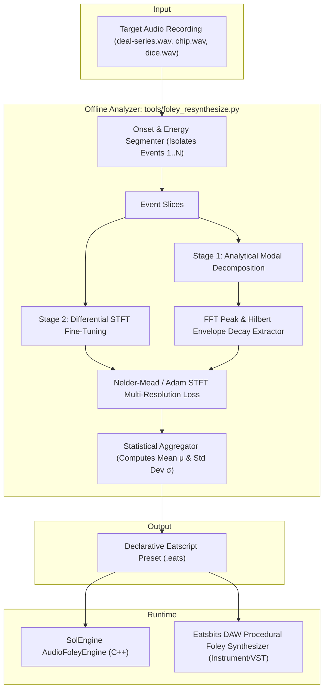

# Procedural Foley Resynthesis & Variance Pipeline
**SolEngine, Eatsbits Core & Eatsbits DAW Architecture**

---

## 1. Executive Summary & Architectural Vision

SolEngine features a low-latency procedural audio engine ([`audio_foley.hpp`](file:///c:/git/solengine/include/solengine/audio_foley.hpp) / [`audio_foley.cpp`](file:///c:/git/solengine/src/audio/audio_foley.cpp)) that synthesizes card handling sound effects using Velvet Noise micro-impulses, Dirac edge transients, and biquad filters without external WAV sample dependencies.

While responsive and lightweight, procedural synthesis often diverges from real-world recordings because simplified geometric waves (square-wave Dirac chirps, swept triangle waves) lack the complex thin-plate modal resonances, pre-snap friction mechanics, and subtle human timing variations found in acoustic card play.

This document specifies a **Two-Stage Automated Foley Resynthesis and Variance Pipeline**. The pipeline takes multi-event reference recordings (such as [`cardsounds/deal-series.wav`](file:///c:/git/solengine/cardsounds/deal-series.wav)), analyzes their acoustic and statistical physics, and generates declarative Eatscript (`.eats`) procedural presets that:
1. Resynthesize arbitrary percussive/contact foley sounds (cards, chips, dice, table knocks, chimes).
2. Reproduce human micro-variance across repeated actions, eliminating the "machine gun" effect.
3. Feed directly into SolEngine for real-time game audio and into **Eatsbits DAW** as a procedural instrument / sound design generator.

---

## 2. Acoustic Analysis of Reference Recording (`deal-series.wav`)

An empirical signal analysis of [`cardsounds/deal-series.wav`](file:///c:/git/solengine/cardsounds/deal-series.wav) (44.1 kHz, 32-bit float stereo, 3.335s) reveals 11 distinct human card deals spaced across $\sim 0.30\text{--}0.40\,\text{s}$ intervals:

```
Event  1: t = 0.162s  (peak 0.048)  |  Event  7: t = 1.838s  (peak 0.063)
Event  2: t = 0.567s  (peak 0.072)  |  Event  8: t = 2.227s  (peak 0.052)
Event  3: t = 0.838s  (peak 0.033)  |  Event  9: t = 2.516s  (peak 0.052)
Event  4: t = 1.177s  (peak 0.021)  |  Event 10: t = 2.838s  (peak 0.055)
Event  5: t = 1.297s  (peak 0.026)  |  Event 11: t = 3.151s  (peak 0.050)
Event  6: t = 1.521s  (peak 0.084)
```

### Micro-Temporal Structure of a Real Card Deal

In contrast to our current procedural `Deal` (which triggers a snap at $t=0$ followed by a 200 ms baize slide at $+22\,\text{ms}$), a real deal consists of four distinct acoustic stages:

```
  -15 ms         -1 ms   0 ms    +3 ms       +12 ms       +25 ms       +40 ms
----+--------------+------+-------+-----------+------------+------------+---->
    |  Thumb Peel  | Edge | Card Modal Ring   | Air Flight | Felt Landing     |
    |  Friction    | Snap | (2.6k, 3.9k, 5.1k)| Trailing   | Micro Double-Tap |
    |  (7-9 kHz)   | Pop  |                   | Whisper    | (320 Hz + slap)  |
```

1. **Pre-Snap Thumb Peel Friction ($-15\,\text{ms} \to -1\,\text{ms}$):**
   * High-frequency epidermal friction as the dealer's thumb slides across the top card.
   * Energy is low ($\approx 20\text{--}30\%$ of peak) with high spectral centroid ($6.5\text{--}9\,\text{kHz}$).
2. **Dirac Edge Release ($0\,\text{ms} \to +2\,\text{ms}$):**
   * The instantaneous release of elastic tension as the card pops off the thumb/deck lip.
   * Needle-sharp impulse ($< 1.5\,\text{ms}$) exciting the card's mechanical structure.
3. **Thin-Plate Cardboard Modal Resonances ($+2\,\text{ms} \to +20\,\text{ms}$):**
   * Laminated cardstock acts as a 2D thin plate. FFT analysis across events isolates four prominent resonant clusters:
     $$\mathbf{f_1} \approx 2.64\,\text{kHz}, \quad \mathbf{f_2} \approx 3.95\,\text{kHz}, \quad \mathbf{f_3} \approx 5.12\,\text{kHz}, \quad \mathbf{f_4} \approx 6.83\,\text{kHz}$$
   * Because of internal damping in cellulose fibers and air acoustic radiation, these modes have low Q-factors ($Q \approx 6\text{--}14$) and decay within $10\text{--}25\,\text{ms}$.
4. **Baize / Table Landing & Settle ($+12\,\text{ms} \to +35\,\text{ms}$):**
   * A low-frequency surface resonance ($\approx 250\text{--}400\,\text{Hz}$, representing the table/felt wood cavity).
   * Frequent secondary micro-impacts ($8\text{--}15\,\text{ms}$ split) where the trailing card corner or trapped air cushion slaps the felt after initial contact.

---

## 3. The Universal Resynthesis Architecture

To support both SolEngine and Eatsbits DAW, we adopt a **Physical Modal + Stochastic Resynthesis Model**. 

Any mechanical contact or percussive sound can be modeled as:
$$y(t) = \sum_{k=1}^{M} A_k \cdot e^{-\alpha_k t} \cdot \sin(\omega_k t + \phi_k) + \text{Env}_{\text{fric}}(t) \cdot \text{Filter}_{\text{fric}}(\text{Noise}(t)) + \text{Impact}_{\text{surface}}(t - \Delta t)$$



### Stage 1: Fast Analytical Extraction
* **Onset Detection:** Energy thresholding with a 5 ms RMS window splits the audio into isolated transient events.
* **Modal Peak Extraction:** High-resolution FFT peak-picking identifies the top $M$ eigenfrequencies ($f_k$) and their relative gains ($A_k$).
* **Decay Constant Estimation:** Computes the analytical envelope via Hilbert transform on narrow bandpass bands around each peak to fit the exponential decay rate $\alpha_k$ ($Q_k = \pi f_k / \alpha_k$).
* **Friction & Impact Slicing:** Measures pre-transient friction duration ($t_{\text{peel}}$) and secondary impact latency ($\Delta t_{\text{impact}}$).

### Stage 2: Differential STFT Polish & Loss Optimization
* Seeding the optimizer with Stage 1's analytical values eliminates the local-minima problem typical of audio optimization.
* A multi-resolution Short-Time Fourier Transform (STFT) loss compares the synthetic signal against the target:
  $$\mathcal{L}_{\text{total}} = \mathcal{L}_{\text{spectral\_mag}} + \lambda_1 \mathcal{L}_{\text{spectral\_log}} + \lambda_2 \mathcal{L}_{\text{envelope\_l1}}$$
* The optimizer refines the friction filter cutoffs, noise bandwidth, and attack/decay slopes.

### Multi-Event Statistical Variance Modeling
Instead of returning a single static parameter set, analyzing all 11 deals in [`deal-series.wav`](file:///c:/git/solengine/cardsounds/deal-series.wav) yields an empirical normal distribution for every parameter:
$$\theta_j \sim \mathcal{N}(\mu_j, \sigma_j^2)$$

This translates directly into the `Base` ($\mu$) and `Dev` ($\sigma / \mu$) parameters native to SolEngine's [`audio_foley.hpp`](file:///c:/git/solengine/include/solengine/audio_foley.hpp).

---

## 4. SolEngine Engine DSP Upgrades

To execute the resynthesized model in real-time, `AudioFoleyEngine` receives three modular enhancements:

### 1. Parallel Modal Resonator Bank
Instead of relying solely on a swept square-wave Dirac chirp, a 4-pole resonator bank executes four parallel 2nd-order biquad bandpass filters driven by a normalized impulse $\delta[0]$:

```cpp
struct ModalResonator {
    float freq{2640.0f};
    float decayRate{55.0f}; // alpha = 1 / tau
    float gain{1.0f};
    AudioFoleyEngine::BiquadFilter filter;
};
```

### 2. Multi-Stage Pipeline for `FoleySound::Deal`
The deal trigger is updated to schedule the full physical sequence:

```cpp
case FoleySound::Deal: {
    const float pitchJitter = 1.0f + (nextNoise() * 0.045f * varScale);
    const float peelDur     = 0.016f * (1.0f + nextNoise() * 0.18f * varScale);
    const float landingDelay = peelDur + 0.022f * (1.0f + nextNoise() * 0.20f * varScale);

    // 1. Pre-snap thumb peel friction (starts immediately at t = 0)
    allocateVoice(makePeelVoice(0.0f, peelDur, intensity * 0.35f, pan));

    // 2. Dirac snap & modal card flex (fires at t = peelDur)
    allocateVoice(makeModalSnapVoice(peelDur, intensity * 0.95f, pitchJitter, pan));

    // 3. Felt landing thud & micro-settle (fires at t = landingDelay)
    allocateVoice(makeDropVoice(landingDelay, intensity * 0.65f, pan));

    // 4. Trailing baize whisper (subtle air slide)
    allocateVoice(makeSlideVoice(landingDelay + 0.005f, intensity * 0.40f, 0.080f, pan));
    break;
}
```

---

## 5. Declarative Eatscript Schema (`.eats`)

The output of the offline pipeline is a clean, declarative `.eats` script that can be loaded at runtime via [`loadFromEatsFile()`](file:///c:/git/solengine/src/audio/audio_foley.cpp#L1072-L1150):

```eats
# ==============================================================================
# Auto-Resynthesized from cardsounds/deal-series.wav
# Extracted from 11 human deal events with empirical variance
# ==============================================================================

audio.set_master_volume(0.85)
audio.set_master_variance(1.0)

audio.define_sound("card_deal_series", {
    # 4-pole thin-plate card flexure eigenmodes
    modes: [
        { freq_base: 2640.0, freq_dev: 0.040, decay_base: 0.016, decay_dev: 0.08, gain: 0.85 },
        { freq_base: 3950.0, freq_dev: 0.045, decay_base: 0.012, decay_dev: 0.08, gain: 0.95 },
        { freq_base: 5120.0, freq_dev: 0.055, decay_base: 0.009, decay_dev: 0.10, gain: 0.65 },
        { freq_base: 6830.0, freq_dev: 0.065, decay_base: 0.007, decay_dev: 0.12, gain: 0.40 }
    ],

    # Pre-snap thumb peel friction
    peel_friction: {
        duration_base: 0.016,
        duration_dev:  0.20,
        filter_cutoff: 7500.0,
        filter_q:      1.4,
        gain_base:     0.32
    },

    # Baize / felt landing & micro-settle
    landing: {
        delay_base:        0.024,
        delay_dev:         0.22,
        frequency_base:    320.0,
        gain_base:         0.55,
        double_tap_chance: 0.45,
        double_tap_split:  0.011
    }
})
```

---

## 6. Eatsbits DAW Integration

Because Eatsbits DAW and SolEngine share the Eatsbits runtime and Eatscript parser, this pipeline serves both engines:

1. **In SolEngine:** The game engine triggers real-time sound effects during card interactions (`triggerSound(FoleySound::Deal, velocity, pan)`). The sounds have zero WAV asset dependencies, instant load times, zero disk footprint, and infinite organic variety.
2. **In Eatsbits DAW:** The exact same `.eats` preset functions as a **Procedural Foley Instrument / Track Plugin**. Composers and sound designers can sequence card deals, chip handling, dice rolls, or UI clicks directly using standard MIDI notes and velocity curves without managing gigabyte-sized sample libraries.

---

## 7. Implementation Roadmap

### Phase 1: Python Offline Analyzer (`tools/foley_resynthesize.py`)
- [ ] Implement transient auto-segmentation on `cardsounds/deal-series.wav` (and other reference files).
- [ ] Implement analytical modal extraction (FFT peak detection + Hilbert exponential decay fitting).
- [ ] Compute population statistics ($\mu$ and $\sigma$) across all segmented events.
- [ ] Implement automated `.eats` code generator.

### Phase 2: SolEngine Audio Engine Updates (`audio_foley.hpp/cpp`)
- [ ] Add the 4-pole modal resonator bank to `Voice`.
- [ ] Implement the multi-stage deal sequence (`Peel` $\to$ `Snap Modal` $\to$ `Landing`).
- [ ] Wire the modal bank and sequence parameters to the Eatscript evaluator.

### Phase 3: Verification & Sound Bank Delivery
- [ ] Process all files in `cardsounds/`:
  - `deal-series.wav` $\to$ `authentic_deal_series.eats`
  - `single.wav` / `single-alternative.wav` $\to$ `authentic_single_deal.eats`
  - `place.wav` $\to$ `authentic_place.eats`
  - `shuffle-loud.wav` / `shuffle-soft.wav` $\to$ `authentic_shuffle.eats`
- [ ] Benchmark CPU overhead in `mixSamples` to ensure zero real-time audio thread regression.

### Phase 4: Eatsbits DAW Export
- [ ] Package the procedural modal generator as a standard Eatsbits DAW instrument module.
