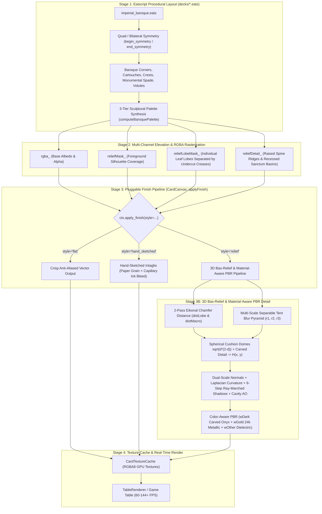

# Procedural Baroque, 3D Bas-Relief & Sketch Art Pipeline

> **Document:** `PROCEDURAL_BAROQUE_ART_PIPELINE.md`  
> **Topic:** Procedural Generation of Baroque/Rococo Decks, Eikonal 3D Bas-Relief Sculpting, Color-Aware PBR Material Shading, and Hand-Sketched Finishes via Eatscript  
> **Target Subsystems:** [`CardCanvas`](file:///c:/git/solengine/include/solengine/card_canvas.hpp), [`card_canvas.cpp`](file:///c:/git/solengine/src/render/card_canvas.cpp), [`CardTextureCache`](file:///c:/git/solengine/include/solengine/card_texture_cache.hpp), [`eatstextures`](file:///c:/git/solengine/include/eatstextures/field_ops.hpp), [`decks/imperial_baroque.eats`](file:///c:/git/solengine/decks/imperial_baroque.eats)

---

## 1. Executive Summary & Eatsbits Core Alignment

Built on **Eatsbits Core**—a modular, ultra-performance engine engineered to minimize binary and runtime asset footprint—SolEngine generates museum-grade playing card decks **100% procedurally in-app** from compact `.eats` scripts (typically `< 6 KB` per 53-card deck), eliminating multi-megabyte bitmap downloads entirely.

While classical decks rely on flat 2D vector layouts, luxury collector decks require **sculpted baroque/rococo acanthus scrollwork, deep 3D bas-relief, burnished 24k gold leaf, and glossy black-on-black carved onyx**. This pipeline delivers those capabilities directly inside [`CardCanvas`](file:///c:/git/solengine/include/solengine/card_canvas.hpp):

1. **Architectural Baroque Ornamental Primitives:** Parametric generation of multi-tiered acanthus corner vignettes (`draw_baroque_corner`), diamond-oval rocaille cartouches (`draw_baroque_cartouche`), royal crown pediments (`draw_baroque_crest`), monumental sculpted spades (`draw_baroque_spade`), logarithmic volutes (`draw_volute`), and beaded pearl borders (`repeat_beads`) with native quad-symmetry (`begin_symmetry` / `end_symmetry`).
2. **True 3D Bas-Relief Sculpting (Eikonal Distance Domes + Cushion Pyramid):** Every drawn primitive records multi-channel elevation metadata (`reliefMask_`, `reliefLobeMask_`, `reliefDetail_`). A 2-pass Eikonal Chamfer distance transform (`chamferDistance2Pass`) combined with a multi-scale tent-blur pyramid shapes every individual acanthus lobe, C-scroll, and emblem into a rounded 3D cushion with deep undercut crevices, multi-scale ambient occlusion, and 6-step ray-marched cast shadows.
3. **Color-Aware PBR Material Shading:**
   - **Glossy Carved Onyx / Obsidian (`wDark`):** Low-luminance/black foreground elements receive slope-gated additive studio reflections and grazing Fresnel rim light—allowing black-on-black carvings to gleam with 3D depth while flat basins remain deep jet-black.
   - **24k Metallic Gold Tone Preservation (`wGold`):** Gold-ish colors use self-tinted metallic specular reflections and a per-channel warm bronze shadow roll-off curve ($\text{mod}^{0.80}, \text{mod}^{1.04}, \text{mod}^{1.52}$), preventing chalky white highlights or muddy grey shadows.
   - **Dielectric Clearcoat (`wOther`):** Preserves rich pigment saturation on crimson hearts/diamonds, antique ivory, and pewter with crisp clearcoat highlights.
4. **Pluggable Artistic Finishes:** Any deck layout can switch seamlessly between `style="relief"`, `style="hand_sketched"`, and `style="flat"` via `ctx.apply_finish(...)`.

---

## 2. Architectural Overview



---

## 3. Stage 1: Symmetrical Baroque Geometry Engine

Baroque ornamentation relies on mathematical rhythm, layered acanthus foliage, and C/S-scroll volutes. [`CardCanvas`](file:///c:/git/solengine/include/solengine/card_canvas.hpp#L75-L96) exposes both foundational parametric curves and high-level architectural centerpiece primitives.

### 3.1 Deferred Symmetry Scope (`begin_symmetry` / `end_symmetry`)
 Implemented in [`CardCanvas::beginSymmetry`](file:///c:/git/solengine/src/render/card_canvas.cpp#L664-L702) and [`CardCanvas::endSymmetry`](file:///c:/git/solengine/src/render/card_canvas.cpp#L670-L702):
- Drawing commands issued inside a symmetry block execute immediately for the top-left (canonical) quadrant and are queued in `symmetryQueue_`.
- Calling `ctx.end_symmetry()` replays the recorded closures across `(-1, 1)`, `(1, -1)`, and `(-1, -1)` transform matrices centered on `(width_ * 0.5f, height_ * 0.5f)`.

### 3.2 Automatic 3-Tier Sculptural Palette Synthesis (`computeBaroquePalette`)
In [`card_canvas.cpp`](file:///c:/git/solengine/src/render/card_canvas.cpp#L955-L1002), [`computeBaroquePalette`](file:///c:/git/solengine/src/render/card_canvas.cpp#L955-L1002) inspects `primaryCol` and `secondCol` luminance and automatically synthesizes three structural color tiers:
- **`deepHex` (Darkest Tier):** Carves deep undercut shadow casings and inter-lobe separation creases (`reliefLobeMask_ = 0`).
- **`baseHex` (Mid-Tone Albedo):** Fills the main sculpted body of each acanthus sheath, scroll, and bevel frame (`reliefLobeMask_ = 1`).
- **`ridgeHex` (Brightest Tier):** Strokes the central raised spine veins, volute crests, and pearl specular bosses (`reliefDetail_ > 0`).

Regardless of whether a script passes a darker shadow color (e.g. `gold_deep = "#8c7220"`) or a brighter highlight color (e.g. `"#fff8dc"`) as the secondary argument, `computeBaroquePalette` guarantees consistent 3D elevation ordering.

### 3.3 Architectural & Masterpiece Primitives
- **[`drawBaroqueCorner(x, y, size, goldColor, accentColor)`](file:///c:/git/solengine/src/render/card_canvas.cpp#L1120-L1200):** Renders a multi-tiered acanthus corner vignette across three elevation bands: a mid-elevation acanthus calyx and scalloped leaf plumes (`z = 0.62, bulge = 0.85`), a high-bulge fluted C-scroll volute spine (`z = 1.28, bulge = 1.50`), and bulbous terminal scroll-eye bosses (`z = 1.35, bulge = 1.60`).
- **[`drawBaroqueCartouche(cx, cy, rx, ry, goldColor, accentColor, lineWidth)`](file:///c:/git/solengine/src/render/card_canvas.cpp#L1265-L1430):** Constructs a multi-layered acanthus garland wrapping all four quadrants of a classical diamond-oval molded arch: mid-elevation acanthus plumes (`z = 0.68, bulge = 0.88`), a raised inner molded arch (`z = 0.82, bulge = 1.00`), and high-bulge lateral wing C-scrolls with bulbous scroll-eye terminals (`z = 1.32, bulge = 1.56`) that overhang the lower gold foliage.
- **[`drawBaroqueCrest(cx, cy, scale, goldColor, accentColor, flipY)`](file:///c:/git/solengine/src/render/card_canvas.cpp#L1202-L1263):** Renders an acanthus crown pediment fan with mid-elevation palmette lobes (`z = 0.66, bulge = 0.88`) and high-bulge outward-curling volutes and fleur-de-lis spear finial (`z = 1.26, bulge = 1.48`).
- **[`drawBaroqueUnderFoliage(cx, cy, rx, ry, foliageColor, accentColor)`](file:///c:/git/solengine/src/render/card_canvas.cpp#L1432-L1498):** Renders a 4-quadrant tapestry of dark charcoal/obsidian acanthus leaves at a recessed background elevation tier (`z = 0.24, bulge = 0.50`) tucked behind the gold cartouche and corner scrolls.
- **[`drawBaroqueSpade(cx, cy, size, bodyColor, filigreeColor, accentColor)`](file:///c:/git/solengine/src/render/card_canvas.cpp#L1500-L1640):** Renders a monumental Ace of Spades at a recessed medallion elevation (`z = 0.28–0.42, bulge = 0.56–0.74`) so it sits deeply nestled inside the surrounding gold cartouche (`z = 0.68–1.36`), complete with a sculpted outer bevel rim, a sunken inner sanctum basin (`z = 0.28`), and low-relief carved filigree (`z = 0.42`).
- **Foundational Curves:** [`drawVolute`](file:///c:/git/solengine/src/render/card_canvas.cpp#L716-L792) (logarithmic spiral with quadratic width taper), [`drawAcanthus`](file:///c:/git/solengine/src/render/card_canvas.cpp#L794-L877) (multi-lobed serrated frond along a quadratic spine), [`repeatBeads`](file:///c:/git/solengine/src/render/card_canvas.cpp#L879-L907), [`strokeCartouche`](file:///c:/git/solengine/src/render/card_canvas.cpp#L909-L963), and [`drawOrnateSuit`](file:///c:/git/solengine/src/render/card_canvas.cpp#L2110-L2195).

---

## 4. Stage 2: Multi-Tier Z-Elevation, Dome Bulge & Eikonal 3D Bas-Relief Engine

A naive 1px luminance emboss only highlights 1-pixel color edges and leaves the interiors of leaves, scrolls, and suit emblems completely flat. Furthermore, single-tier relief treats every foreground shape as having the same height, whereas museum-grade baroque metalwork features a **multi-tiered 3D elevation hierarchy**:
- **Tier 0 (`z = 0.00`):** Flat card bed plate.
- **Tier 1 (`z = 0.16–0.24, bulge = 0.18–0.50`):** Sunken center medallion basin (`z = 0.16`) and dark charcoal acanthus under-foliage (`z = 0.24`) tucked behind the gold ornaments.
- **Tier 2 (`z = 0.28–0.42, bulge = 0.56–0.74`):** Recessed center Ace of Spades emblem sitting significantly lower than the surrounding gold cartouche wall.
- **Tier 3 (`z = 0.62–0.82, bulge = 0.85–1.00`):** Mid-elevation gold acanthus leaf beds and inner cartouche molding.
- **Tier 4 (`z = 1.26–1.36, bulge = 1.48–1.60`):** High-relief primary C-scrolls, lateral cartouche wing scrolls, and bulbous scroll-eye terminals that bulge upward toward the camera and cast shadows onto lower gold and dark tiers.

To achieve true multi-tier sculpted 3D bas-relief, [`CardCanvas`](file:///c:/git/solengine/include/solengine/card_canvas.hpp#L140-L154) records **five** structural height channels during rasterization and solves a multi-scale Eikonal distance-transform dome heightfield in [`CardCanvas::applyFinish`](file:///c:/git/solengine/src/render/card_canvas.cpp#L1645-L2020).

### 4.1 Five-Channel Elevation & Bulge Buffers
Every primitive and NanoSVG fragment rasterized through [`CardCanvas::compositeBuffer`](file:///c:/git/solengine/src/render/card_canvas.cpp#L68-L148), [`fillRect`](file:///c:/git/solengine/src/render/card_canvas.cpp#L168-L234), [`fillRoundedRect`](file:///c:/git/solengine/src/render/card_canvas.cpp#L264-L344), and [`fillOval`](file:///c:/git/solengine/src/render/card_canvas.cpp#L377-L440) updates:
1. **`reliefMask_[i]` $\in [0, 1]$ (Macro Silhouette Coverage):**
   - Full-card plate fills (`clear`, `fillRect(0, 0, w, h)`, `fillRoundedRect` covering $\ge 85\%$ of the canvas) set `reliefMask_ = 0.0f` (the flat recessed card bed).
   - Interior medallion wells (`fillOval` inside the cartouche) set `reliefMask_ = 0.16f`, `reliefElevation_ = 0.16f`, `reliefBulge_ = 0.18f`, and `reliefDetail_ = -0.26f` (sunken chamber).
   - All ornamental foreground paths set `reliefMask_ = max(reliefMask_, alpha)`.
2. **`reliefLobeMask_[i]` $\in [0, 1]$ (Individual Leaf & Scroll Lobe Mask):**
   - Distinguishes raised leaf bodies (`lum >= 0.14`) from dark undercut crease strokes (`deepHex`) and recessed sanctum fills (`lum < 0.14`).
   - Also detects **Z-elevation step boundaries**: when a higher-elevation gold C-scroll (`z = 1.32`) is rasterized over a lower-elevation gold leaf (`z = 0.62`), anti-aliased edge pixels drop `reliefLobeMask_` so the upper scroll forms a distinct 3D dome over the lower gold layer.
3. **`reliefDetail_[i]` $\in [-0.45, +0.90]$ (Fine Chiseled Spine & Cavity Relief):**
   - Captures internal luminance contrast (`ridgeHex` central leaf veins and pearl highlights push `reliefDetail_` positive; `deepHex` grooves push `reliefDetail_` negative).
4. **`reliefElevation_[i]` $\in [0.0, 2.5]$ (Multi-Tier Z-Height Pedestal):**
   - Controlled via [`CardCanvas::setElevation(zBase, bulge)`](file:///c:/git/solengine/src/render/card_canvas.cpp#L56-L65) (`ctx.set_elevation(z, bulge)` in Eatscript) and automatically modulated across multi-pass baroque primitives.
5. **`reliefBulge_[i]` $\in [0.1, 2.5]$ (3D Cushion Dome Inflation Multiplier):**
   - Scales the spherical Eikonal dome curvature so high-tier C-scrolls and scroll-eye knobs (`bulge = 1.50–1.60`) puff upward toward the camera with steep rounded cross-sections while low-relief background leaves (`bulge = 0.50`) remain subtly sculpted.

### 4.2 2-Pass Eikonal Chamfer Distance Transform & Intra-Gold Cliff Detection (`chamferDistance2Pass`)
Implemented in [`chamferDistance2Pass`](file:///c:/git/solengine/src/render/card_canvas.cpp#L1063-L1102), the engine computes an exact $O(W \cdot H)$ 2-pass Chamfer $(1, \sqrt{2})$ Euclidean distance field in sub-millisecond CPU time:
- **Intra-Layer Z-Cliff Seeding (`lobeSeed`):** Before running the lobe distance transform, [`CardCanvas::applyFinish`](file:///c:/git/solengine/src/render/card_canvas.cpp#L1685-L1712) checks each pixel's 4-connected neighbors for elevation cliffs (`zCur - zNbr > 0.12f`). Pixels on the upper lip of an elevation step are seeded with `lobeSeed = 0.0f`, forcing the Eikonal distance field to inflate a fresh 3D cushion dome right from the overhang boundary—even when both the upper C-scroll and lower acanthus leaf share the exact same gold color!
- **Dual Structural Scales:**
  1. **`distLobe`** (on `lobeSeed`, capped at `maxLobeDist = 8.5px * scaleFactor`): Distance from the nearest leaf/scroll undercut crease or Z-elevation cliff.
  2. **`distMacro`** (on `reliefMask_`, capped at `maxMacroDist = 20.0px * scaleFactor`): Distance from the outer silhouette boundary.

### 4.3 Multi-Tier Spherical Cushion Profile & Heightfield Synthesis
Normalized distances $d_{\text{lobe}}, d_{\text{macro}} \in [0, 1]$ are shaped through a spherical cushion dome profile:
$$h_{\text{dome}}(d) = \sqrt{d\,(2 - d)}$$
Combined with the smoothed Z-elevation pedestal $E_{\text{smooth}}(x, y)$, dome bulge multiplier $B_{\text{smooth}}(x, y)$, 3-tier separable tent-blur pyramid (`blur1`, `blur2`), and fine spine detail (`detailSmooth`):
$$\text{tierBase}(x, y) = m \cdot \left(0.48\,E_{\text{smooth}} + 0.10\,b_1\right)$$
$$\text{cushionVolume}(x, y) = m \cdot B_{\text{smooth}} \cdot \left(0.46\,h_{\text{dome}}(d_{\text{lobe}}) + 0.22\,h_{\text{dome}}(d_{\text{macro}}) + 0.12\,b_2\right)$$
$$H_{\text{raw}}(x, y) = \text{tierBase}(x, y) + \text{cushionVolume}(x, y) + (0.55 + 0.45\,B_{\text{smooth}})\cdot\left(0.44\,D_{\text{smooth}} + 0.24\,D_{\text{raw}}\right)$$
A final C1-continuous tent filter produces the differentiable heightfield $H(x, y)$.

### 4.4 Dual-Scale Normals, Overhang Step AO & Multi-Tier Ray-Marched Shadows
At each pixel $(x, y)$:
- **Dual-Scale Surface Normals:** Blends 1px central differences ($65\%$, crisp filigree bevels) and 2px central differences ($35\%$, broad cushion domes) into $\mathbf{N} = \text{normalize}(-dz/dx, -dz/dy, 1)$.
- **Local Mean Curvature:** Compares $H(x, y)$ against a 3px box-blurred reference $\bar{H}(x, y)$ to extract convex `ridge` crests and concave `crevice` grooves.
- **Overhang Step Ambient Occlusion (`stepOverhangOcc`):** Wherever a lower elevation tier sits adjacent to a higher elevation tier (`E_smooth(x, y) < E_blur(x, y)`), the tucked under-layer receives deep overhang ambient occlusion (`stepOverhangOcc`), naturally darkening recessed charcoal under-foliage and lower gold acanthus leaves beneath overhanging C-scrolls.
- **Multi-Tier Horizon Ray-Marched Cast Shadows (`castShadow`):** Marches 7 steps (`1.5px` to `21.0px`) toward the key light source `(rayDirX, rayDirY)`. Because high-relief gold cartouche walls (`z ≈ 1.32`) stand physically taller than the sunken medallion basin (`z = 0.16`), the recessed Spade (`z = 0.28–0.42`), and the background under-foliage (`z = 0.24`), upper tiers cast crisp directional shadows across lower tiers.
- **Camera-Proximity Exposure & Bulge Specular Boost:** Elements at higher Z-elevation (`elevProximity`) and higher bulge (`bulgeSpecBoost`) receive subtly brighter key-light exposure and tighter specular glints, while recessed tiers sit deeper in atmospheric shadow.

---

## 5. Stage 3: Color-Aware Material Classification & PBR Shading

A critical requirement of luxury baroque decks is handling **extreme material contrast** on the same card:
- **Dark/black elements** (such as a carved black onyx Ace of Spades) must shine with dramatic 3D specular depth without washing flat basins out to grey.
- **Gold-ish elements** must retain their warm metallic 24k gold tone across both bright highlights and deep shadows.

[`CardCanvas::applyFinish`](file:///c:/git/solengine/src/render/card_canvas.cpp#L1695-L1830) classifies every pixel continuously into three physical material weights from its unlit albedo $(r_0, g_0, b_0)$ and luminance $L_0$:

### 5.1 Slope-Gated Specular (`slopeGate`)
On a horizontal flat surface ($\mathbf{N} = (0, 0, 1)$) lit from $45^\circ$ elevation, the half-vector dot product $\mathbf{N} \cdot \mathbf{H}$ is still $\approx 0.92$, which would cause unweighted Blinn-Phong specular to fog flat black basins into milky grey.
The shader gates broad and mid specular lobes by surface slope and convex ridge curvature:
$$\text{slopeGate} = \text{clamp}\left(2.3\,\sqrt{n_x^2 + n_y^2} + 0.7\,\max(0, \text{ridge}),\; 0.0,\; 1.0\right)$$
Flat basins have $\text{slopeGate} = 0$ (remaining $100\%$ deep jet-black), while curved 3D slopes, bevel rims, and filigree ridges catch bright studio reflections.

### 5.2 Material Branch A: Glossy Carved Onyx / Obsidian (`wDark`)
Activated for low-luminance foreground relief ($L_0 < 0.36$, `m > 0`):
- **Additive Studio Sheen & Rim Light:** Because multiplicative diffuse shading (`0 * N·L = 0`) produces zero contrast on black albedo, `wDark` adds a warm silver-pewter studio sheen (`specBroad`, `specMid`, `ridgeGlint`), a counter-azimuth grazing Fresnel rim highlight (`specRim`), and a crisp highlight glint (`specSharp` $\propto (\mathbf{N}\cdot\mathbf{H})^{52}$) directly onto the sloped 3D geometry.

### 5.3 Material Branch B: 24k Metallic Gold (`wGold`)
Activated for warm chromaticity pixels ($r_0 > g_0 > b_0$):
- **Warm Bronze Shadow Roll-Off:** Instead of multiplying $(r_0, g_0, b_0)$ equally by `diffMod` (which turns shadowed gold into muddy olive-grey), gold diffuse light uses a per-channel power curve:
  $$R_{\text{diff}} = r_0 \cdot \text{mod}^{0.80}, \quad G_{\text{diff}} = g_0 \cdot \text{mod}^{1.04}, \quad B_{\text{diff}} = b_0 \cdot \text{mod}^{1.52}$$
  In shadow ($\text{mod} < 1$), blue drops fastest and red holds longest, shifting shadowed gold into a rich, warm antique bronze/umber.
- **Self-Tinted Metallic Specular:** Metals tint their reflections by their own base chromaticity. Broad and mid specular lobes are multiplied by `metalTint` (derived from normalized $(r_0, g_0, b_0)$), while only the sharpest peak glints ($\text{specSharp}$) blend toward champagne-gold `highlightColor`.

### 5.4 Material Branch C: Dielectric Clearcoat (`wOther`)
Activated for non-gold, non-black foreground elements (crimson hearts/diamonds, ivory scrolls, silver/pewter):
- Preserves diffuse pigment hue and layers a physical clearcoat specular lobe on top.

---

## 6. Stage 4: The Hand-Sketched & Engraved Finish (`style="hand_sketched"`)

For decks targeting a vintage intaglio or hand-printed aesthetic, `ctx.apply_finish(style="hand_sketched", paper_grain=0.15, ink_bleed=0.20)` applies:
1. **Deterministic Spatial Hash Paper Grain:** Modulates pixel RGB values with a high-frequency deterministic hash noise (`paperGrain`) simulating cotton rag paper tooth.
2. **Capillary Ink Bleed:** Modulates anti-aliased stroke boundary alpha (`10 < a < 245`) with fiber noise (`inkBleed`), emulating capillary ink absorption along pen edges.

---

## 7. Concrete Eatscript API Reference

### 7.1 Symmetry, Multi-Tier Elevation & Scoping
* `ctx.begin_symmetry(mirror_x=True, mirror_y=True)` / `ctx.end_symmetry()`  
  Executes all drawing commands between `begin_symmetry` and `end_symmetry` with automatic 4-quadrant (or bilateral) reflection across the card's center axes.
* `ctx.set_elevation(z_base, bulge=1.0)` / `ctx.reset_elevation()`  
  Sets the explicit Z-elevation pedestal (`z_base` $\in [0.0, 2.5]$) and 3D dome inflation multiplier (`bulge` $\in [0.1, 2.5]$) for subsequent drawing primitives. High-tier scrolls (`z_base=1.32, bulge=1.56`) bulge upward toward the camera and cast ray-marched shadows onto mid-tier gold foliage (`z_base=0.62, bulge=0.85`), recessed suit emblems (`z_base=0.35, bulge=0.65`), and background charcoal under-foliage (`z_base=0.22, bulge=0.48`).

### 7.2 Architectural & Masterpiece Baroque Primitives
* `ctx.draw_baroque_corner(x, y, size, gold_color="#d4af37", accent_color="#8c7220")`  
  Renders a multi-tiered acanthus corner vignette with mid-elevation leaves (`z = 0.62`), a high-bulge fluted C-scroll spine (`z = 1.28, bulge = 1.50`), and bulbous terminal scroll-eye bosses (`z = 1.35, bulge = 1.60`).
* `ctx.draw_baroque_cartouche(cx, cy, rx, ry, gold_color="#d4af37", accent_color="#8c7220", line_width=2.8)`  
  Renders a 4-quadrant acanthus garland wrapping a molded diamond-oval arch (`z = 0.68–0.82`) crowned by high-bulge lateral wing C-scrolls and bulbous scroll-eye terminals (`z = 1.32, bulge = 1.56`).
* `ctx.draw_baroque_crest(cx, cy, scale, gold_color="#d4af37", accent_color="#8c7220", flip_y=False)`  
  Renders a royal acanthus pediment fan (`z = 0.66`) with high-bulge dual volutes and fleur-de-lis finial (`z = 1.26, bulge = 1.48`).
* `ctx.draw_baroque_under_foliage(cx, cy, rx, ry, foliage_color="#1c1e26", accent_color="#0b0c10")`  
  Renders a 4-quadrant tapestry of dark charcoal/obsidian acanthus leaves at a recessed background elevation (`z = 0.24, bulge = 0.50`) tucked behind the gold scrollwork.
* `ctx.draw_baroque_spade(cx, cy, size, body_color="#14151a", filigree_color="#d4af37", accent_color="#8c7220")`  
  Renders a monumental Ace of Spades at a recessed medallion elevation (`z = 0.28–0.42, bulge = 0.56–0.74`) with a sculpted outer bevel, sunken inner sanctum basin, central palmette spine, and symmetrical acanthus scrollwork.

### 7.3 Foundational Ornamental Primitives
* `ctx.draw_volute(cx, cy, radius, turns=1.25, angle_start=0.0, color="#d4af37", width=3.5, profile="fluted_ridge")`  
  Renders an expanding logarithmic spiral flourish with a 3-tier sculpted ridge.
* `ctx.draw_acanthus(from=[x1, y1], to=[x2, y2], lobes=5, curl_dir="left", color="#ede6d6", stroke="#d4af37", stroke_width=1.2)`  
  Renders a multi-lobed acanthus leaf cluster along a quadratic guide curve with internal vein ridges.
* `ctx.stroke_cartouche(cx, cy, rx, ry, style="baroque_oval", color="#d4af37", line_width=2.5)`  
  Renders a lightweight ornamental frame medallion (ideal for keeping number cards 2–10 open and legible).
* `ctx.repeat_beads(inset, radius=3.5, spacing=10.0, color="#d4af37")`  
  Stamps 3D shaded beaded pearls with specular highlights along the card perimeter.
* `ctx.draw_ornate_suit(suit, cx, cy, size, body_color, filigree_color="#d4af37")`  
  Renders a large suit emblem inlaid with baroque volute filigree and a central rosette boss.

### 7.4 Relief & Shading Finishes
* `ctx.apply_finish(style="relief" | "hand_sketched" | "flat", light_azimuth=135.0, light_elevation=45.0, ao_intensity=1.6, relief_depth=4.0, patina_color="#0b0c0e", highlight_color="#fff5d0", paper_grain=0.15, ink_bleed=0.20)`  
  Executes the global surface post-process on the canvas before uploading to [`CardTextureCache`](file:///c:/git/solengine/include/solengine/card_texture_cache.hpp).

---

## 8. Production Deck Recipe (`decks/imperial_baroque.eats`)

Below is the complete, shipping [`decks/imperial_baroque.eats`](file:///c:/git/solengine/decks/imperial_baroque.eats) deck recipe demonstrating quad-symmetry, multi-tier 3D elevation (dark charcoal under-foliage, sunken medallion wells, low-elevation center Spade, mid-tier gold acanthus leaves, and high-bulge gold C-scrolls), and clean number-card typography:

```python
# SolEngine Deck Recipe — Imperial Baroque (Procedural 3D Bas-Relief)
sol.set_theme({
    id: "imperial_baroque",
    name: "Imperial Baroque (Procedural Relief)",
    author: "SolEngine Procedural Engine",
    description: "Museum-grade baroque playing cards with multi-tier sculpted bas-relief, antique gold filigree, and ivory accents.",
    version: 2,
    corner_radius: 6.0
})

def on_draw_card_face(ctx, rank, suit, w, h):
    is_red = (suit == "hearts" or suit == "diamonds")
    pip_color = "#14151a"
    if is_red:
        pip_color = "#b81424"

    gold_trim    = "#d4af37"
    gold_deep    = "#8c7220"
    ivory_card   = "#f7f3e8"
    ivory_accent = "#ede5d4"

    cx = w * 0.5
    cy = h * 0.5
    is_court = (rank == "J" or rank == "Q" or rank == "K")
    is_ace   = (rank == "A")

    # 1. Base ivory card plate with layered gold borders
    ctx.fill_rounded_rect(0, 0, w, h, 6.0, ivory_card)
    ctx.stroke_rounded_rect(0, 0, w, h, 6.0, gold_trim, 2.0)
    ctx.stroke_rounded_rect(3.5, 3.5, w - 7.0, h - 7.0, 4.0, gold_deep, 1.0)

    # 2. Beaded pearl perimeter
    ctx.repeat_beads(inset=12.0, radius=2.2, spacing=8.0, color=gold_trim)
    ctx.stroke_rounded_rect(17.0, 17.0, w - 34.0, h - 34.0, 3.5, ivory_accent, 0.8)

    # 3. Corner Baroque Acanthus Vignettes (Quad-Symmetrical)
    corner_size = 38.0
    if is_ace or is_court:
        corner_size = 50.0

    ctx.begin_symmetry(mirror_x=True, mirror_y=True)
    ctx.draw_baroque_corner(22.0, 22.0, corner_size, gold_trim, gold_deep)
    ctx.end_symmetry()

    # 4. Central Presentation based on Card Type
    if is_ace:
        rx = w * 0.38
        ry = h * 0.34
        # Tier 1 (Low-Relief Under-Layer): Dark charcoal acanthus foliage tucked behind the gold cartouche
        if suit == "spades":
            ctx.draw_baroque_under_foliage(cx, cy, rx * 0.96, ry * 0.96, "#1f222b", "#0d0e13")
            # Sunken bronze-taupe medallion well (z = 0.16)
            ctx.fill_oval(cx, cy, rx=rx * 0.65, ry=ry * 0.62, color="#3a2e21")

        # Tiers 3 & 4 (Mid-Relief Foliage + High-Bulge C-Scrolls): Gold cartouche and royal crests
        ctx.draw_baroque_cartouche(cx, cy, rx, ry, gold_trim, gold_deep, 2.6)
        ctx.draw_baroque_crest(cx, cy - ry * 1.02, 1.0, gold_trim, gold_deep, False)
        ctx.draw_baroque_crest(cx, cy + ry * 1.02, 1.0, gold_trim, gold_deep, True)

        # Tier 2 (Recessed Medallion Emblem): Center Spade sits at significantly lower elevation than gold scrolls
        if suit == "spades":
            ctx.draw_baroque_spade(cx, cy, w * 0.40, pip_color, "#282b36", "#0b0c10")
        else:
            ctx.set_elevation(0.45, 0.72)
            ctx.draw_ornate_suit(suit, cx=cx, cy=cy, size=w * 0.38, body_color=pip_color, filigree_color=gold_trim)
            ctx.reset_elevation()

    elif is_court:
        margin_x = w * 0.19
        margin_y = h * 0.17
        inner_w  = w - margin_x * 2.0
        inner_h  = h - margin_y * 2.0
        ctx.draw_court(rank, suit, margin_x, margin_y, inner_w, inner_h, 1.0, gold_trim)

    else:
        rx = w * 0.35
        ry = h * 0.30
        ctx.stroke_cartouche(cx, cy, rx=rx, ry=ry, style="baroque_oval", color=gold_trim, line_width=1.2)
        ctx.draw_pip_layout(rank, suit, w, h, color=pip_color)

    # 5. Corner Indices
    ctx.draw_corner_indices(rank, suit, w, h, color=pip_color, font_size=26.0)

    # 6. Apply sculpted 3D bas-relief finish
    ctx.apply_finish(style="relief", light_azimuth=135.0, light_elevation=48.0, ao_intensity=1.25, relief_depth=3.2)

def on_draw_card_back(ctx, w, h):
    gold_trim  = "#d4af37"
    gold_deep  = "#8c7220"
    slate_bg   = "#0e0f13"
    slate_card = "#14161d"

    cx = w * 0.5
    cy = h * 0.5

    # 1. Base plate with layered gold borders
    ctx.fill_rounded_rect(0, 0, w, h, 6.0, slate_bg)
    ctx.fill_rounded_rect(3.0, 3.0, w - 6.0, h - 6.0, 4.5, slate_card)
    ctx.stroke_rounded_rect(0, 0, w, h, 6.0, gold_trim, 2.0)
    ctx.stroke_rounded_rect(4.0, 4.0, w - 8.0, h - 8.0, 4.0, gold_deep, 1.0)

    # 2. Beaded pearl perimeter
    ctx.repeat_beads(inset=12.0, radius=2.4, spacing=8.0, color=gold_trim)
    ctx.stroke_rounded_rect(17.0, 17.0, w - 34.0, h - 34.0, 3.5, "#2a2c38", 0.8)

    rx = w * 0.33
    ry = h * 0.28

    # 3. Tier 1 (Low-Relief Charcoal Under-Foliage): Dark carved leaves behind the gold scrollwork
    ctx.draw_baroque_under_foliage(cx, cy, rx, ry, "#1e212a", "#0b0c10")

    # 4. Sunken Medallion Basin (z = 0.16)
    ctx.fill_oval(cx, cy, rx=rx * 0.68, ry=ry * 0.64, color="#352a1e")

    # 5. Tiers 3 & 4 (Mid-Relief Gold Foliage + High-Bulge C-Scrolls & Knobs)
    ctx.begin_symmetry(mirror_x=True, mirror_y=True)
    ctx.draw_baroque_corner(22.0, 22.0, 56.0, gold_trim, gold_deep)
    ctx.set_elevation(0.64, 0.86)
    ctx.draw_acanthus(from=[22.0, 92.0], to=[22.0, 168.0], lobes=4, curl_dir="right", color=gold_deep, stroke=gold_trim, stroke_width=1.0)
    ctx.set_elevation(1.28, 1.50)
    ctx.draw_volute(cx=cx - 36.0, cy=cy - 36.0, radius=28.0, turns=1.1, angle_start=0.6, color=gold_trim, width=2.6, profile="fluted_ridge")
    ctx.reset_elevation()
    ctx.end_symmetry()

    # 6. Central Baroque Medallion & Royal Cartouche
    ctx.draw_baroque_cartouche(cx, cy, rx, ry, gold_trim, gold_deep, 3.0)
    ctx.draw_baroque_crest(cx, cy - ry * 1.02, 1.05, gold_trim, gold_deep, False)
    ctx.draw_baroque_crest(cx, cy + ry * 1.02, 1.05, gold_trim, gold_deep, True)

    # 7. Tier 2 (Low-Elevation Center Spade): Sits recessed inside the medallion well below the gold cartouche
    ctx.draw_baroque_spade(cx, cy, size=w * 0.27, body_color="#14161c", filigree_color="#2a2d38", accent_color="#0a0b0e")

    # 8. Apply sculpted 3D bas-relief finish
    ctx.apply_finish(style="relief", light_azimuth=135.0, light_elevation=48.0, ao_intensity=1.45, relief_depth=3.4)
```

---

## 9. Performance, Memory & Execution Architecture

### 9.1 Pre-Bake Compilation & Thread-Local Zero-Allocation Reuse
* **Thread-Local Scratch Buffers:** In [`CardCanvas::applyFinish`](file:///c:/git/solengine/src/render/card_canvas.cpp#L1676-L1705), all intermediate distance-transform and pyramid buffers (`lobeSeed`, `distLobe`, `distMacro`, `blur1`, `blur2`, `blur3`, `elevSmooth`, `elevBlur`, `bulgeSmooth`, `detailSmooth`, `heightRaw`, `height`, `tmpBuf`, `pingBuf`) are `thread_local static std::vector<float>`, eliminating heap allocations across the 53-card deck bake.
* **$O(W \cdot H)$ Linear Complexity:** Both the 2-pass Chamfer distance transform (`chamferDistance2Pass`) and sliding-window separable box/tent blurs (`separableBoxBlur`, `separableTentBlur`) execute in strictly $O(1)$ operations per pixel independent of blur radius.
* **Zero Runtime Overhead:** Once baked into [`CardTextureCache`](file:///c:/git/solengine/include/solengine/card_texture_cache.hpp), cards render as standard GPU textures at full monitor refresh rate (`60/120/144+ FPS`) with zero per-frame shader overhead.

---

## 10. Implementation Status

- [x] **Phase 1: 2D Symmetrical Curves & Architectural Baroque Motitives**
  - Implemented `begin_symmetry` / `end_symmetry` closure replay in [`card_canvas.cpp`](file:///c:/git/solengine/src/render/card_canvas.cpp#L676-L714).
  - Implemented `draw_volute`, `draw_acanthus`, `repeat_beads`, `stroke_cartouche`, `draw_ornate_suit`, `draw_baroque_corner`, `draw_baroque_cartouche`, `draw_baroque_crest`, `draw_baroque_under_foliage`, and `draw_baroque_spade`.
- [x] **Phase 2: Hand-Sketched / Engraved Finish**
  - Implemented deterministic paper grain and capillary ink bleed in [`CardCanvas::applyFinish`](file:///c:/git/solengine/src/render/card_canvas.cpp#L1618-L1642).
- [x] **Phase 3: Multi-Tier Eikonal 3D Bas-Relief & Color-Aware PBR Shading**
  - Implemented 5-channel elevation & dome bulge recording (`reliefMask_`, `reliefLobeMask_`, `reliefDetail_`, `reliefElevation_`, `reliefBulge_`) across all `CardCanvas` primitives and NanoSVG rasterization.
  - Implemented intra-layer Z-cliff detection (`lobeSeed`), 2-pass Chamfer Euclidean distance domes (`chamferDistance2Pass`), multi-tier cushion synthesis, overhang step AO (`stepOverhangOcc`), 7-step horizon ray-marched shadows, slope-gated carved onyx specular (`wDark`), and warm 24k metallic gold shading (`wGold`).
- [x] **Phase 4: Built-in Procedural Baroque Deck**
  - Shipped [`decks/imperial_baroque.eats`](file:///c:/git/solengine/decks/imperial_baroque.eats) v2 with multi-tier 3D bas-relief.
