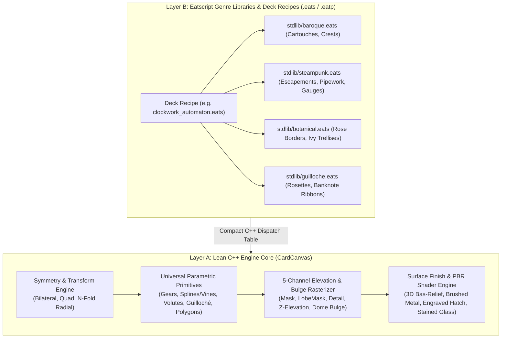
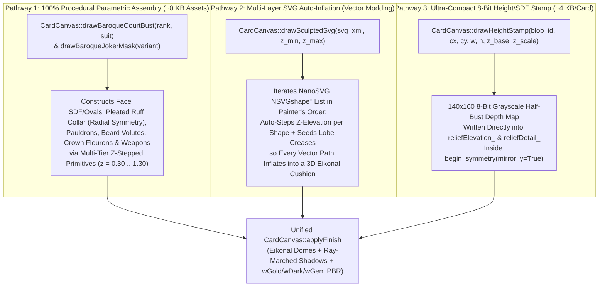

# SolEngine & Eatsbits: General Procedural Art Pipeline & Architecture Guide

**Status:** Master Architectural Blueprint & Multi-Genre Expansion Roadmap  
**Engine Scope:** Eatsbits Core / SolEngine Procedural Asset Synthesis (`CardCanvas`, `Eatscript`, `.eats` / `.eatp`)  
**Related Specifications:**
* [`PROCEDURAL_BAROQUE_ART_PIPELINE.md`](file:///c:/git/solengine/PROCEDURAL_BAROQUE_ART_PIPELINE.md) — Deep-dive into the Baroque ornamental primitives and 5-tier 3D bas-relief math.
* [`DECK_PIPELINE.md`](file:///c:/git/solengine/DECK_PIPELINE.md) & [`EATSCRIPT_CARD_CUSTOMIZATION.md`](file:///c:/git/solengine/EATSCRIPT_CARD_CUSTOMIZATION.md) — Card deck lifecycle, `.eatp` packaging, and script hooks.
* [`EATSCRIPT_BACKGROUND_PIPELINE.md`](file:///c:/git/solengine/EATSCRIPT_BACKGROUND_PIPELINE.md) — Real-time procedural table & environment shaders.

---

## 1. Executive Philosophy: The "Zero-Asset" Eatsbits Mandate

SolEngine is built on **Eatsbits Core**, a modular, high-performance C++ engine engineered to minimize runtime binary size while delivering studio-grade visuals at native refresh rates (`60/120/144+ FPS`).

Traditional digital card and tabletop games suffer from massive asset bloat:
* A single 53-card deck exported as high-DPI uncompressed textures or PNG atlases consumes **15 MB to 45 MB** on disk.
* Supporting 10 distinct art genres (Baroque, Clockwork, Steampunk, Botanical/Floral, Lineart/Guilloché, Stained Glass, Celtic, Art Deco, etc.) via static textures easily balloons an installer by **200 MB – 500 MB**.

By generating artwork **directly in-app** through parametric vector mathematics coupled with a 5-channel 3D heightfield and physically-based surface finisher:
1. **2,000× Size Compression:** A complete, museum-grade 53-card deck recipe ([`decks/imperial_baroque.eats`](file:///c:/git/solengine/decks/imperial_baroque.eats)) is **~6.2 KB** of plain text (and **~2 KB** compressed inside an `.eatp` bundle).
2. **Resolution Independence:** Cards rasterize dynamically to whatever target DPI or supersampling resolution the display requires.
3. **Zero Per-Frame GPU Overhead:** Complex procedural synthesis runs **once at deck load** on worker threads and bakes standard RGBA8 textures into [`CardTextureCache`](file:///c:/git/solengine/include/solengine/card_texture_cache.hpp). During gameplay, rendering cost is identical to a static sprite.
4. **Infinite Parametric Variation:** Changing light angles, relief depth, metal alloy chromaticity, gear tooth counts, or vine branching density requires changing a single number in script.

---

## 2. Empirical Binary Footprint Telemetry

To guide architectural decisions between C++ core primitives and scripted modules, below is the exact machine-code footprint measured from the Release build (`build/solengine_render.dir/Release/card_canvas.obj` linked into `build/Release/solengine.exe` at **1,970 KB / 1.92 MB** total):

### 2.1 Breakdown of `CardCanvas` & Baroque 3D Relief in Release Binary

| Subsystem / Function in [`src/render/card_canvas.cpp`](file:///c:/git/solengine/src/render/card_canvas.cpp) | `.text` Machine Code | % of `solengine.exe` | Role & Reusability |
| :--- | ---: | ---: | :--- |
| **[`CardCanvas::applyFinish`](file:///c:/git/solengine/src/render/card_canvas.cpp#L1615-L2020)** | **12,145 B** (11.9 KB) | `0.60%` | **100% Universal:** 5-tier heightfield, Eikonal domes, overhang AO, 7-step ray-marched shadows, PBR gold/onyx/clearcoat, hand-sketched grain/bleed |
| **[`chamferDistance2Pass`](file:///c:/git/solengine/src/render/card_canvas.cpp#L1063-L1102) + Separable Blur Pyramid** | **~3,400 B** (3.3 KB) | `0.17%` | **100% Universal:** $O(W\cdot H)$ Euclidean distance transform & C1 tent filters |
| **[`CardCanvas::compositeBuffer`](file:///c:/git/solengine/src/render/card_canvas.cpp#L68-L148) + Base Shape Fillers** | **~8,200 B** (8.0 KB) | `0.41%` | **100% Universal:** Alpha blending + 5-channel relief/elevation/bulge recording |
| **Foundational Curves ([`drawAcanthus`](file:///c:/git/solengine/src/render/card_canvas.cpp#L794-L877), [`drawVolute`](file:///c:/git/solengine/src/render/card_canvas.cpp#L716-L792), [`repeatBeads`](file:///c:/git/solengine/src/render/card_canvas.cpp#L879-L907))** | **10,939 B** (10.7 KB) | `0.54%` | **Cross-Genre:** Spirals, serrated leaf splines, and pearl/rivet stamping |
| **Bespoke Baroque Assemblies (`drawBaroqueCartouche`, `Corner`, `Crest`, `UnderFoliage`, `Spade`, `OrnateSuit`)** | **36,023 B** (35.2 KB) | `1.78%` | **Genre-Specific:** High-level baroque compositions built from polygons & Beziers |
| **Eatscript Binding Lambdas in [`bindToEvaluator`](file:///c:/git/solengine/src/render/card_canvas.cpp#L2215-L2735)** | **~18,500 B** (18.1 KB) | `0.92%` | **Binding Overhead:** `std::function` type-erasure wrappers for script calls |
| **Total Procedural Art + 3D Relief Addition** | **~81.0 KB** | **`~4.0%`** | Complete procedural vector & 3D relief pipeline |

### 2.2 Key Engineering Takeaways from the Telemetry
1. **Pixel Shaders & Math Kernels are Tiny:** The entire 5-tier 3D bas-relief engine, Eikonal distance transform, ray-marched shadow caster, and color-aware PBR material classifier (`applyFinish` + `chamferDistance2Pass`) cost only **15.2 KB** combined.
2. **Composite Genre Motifs & `std::function` Bindings Dominate Size:** High-level assemblies (`drawBaroqueCartouche`, `drawBaroqueSpade`, etc.) and their `std::function` binding templates account for **~53 KB** (two-thirds of the footprint).
3. **Implication for Future Genres:** If we keep **universal math/curve/shader kernels in C++** while moving **composite genre assemblies into reusable Eatscript modules (`.eats`)** and consolidating C++ binding boilerplate, we can add **5+ major new art genres (Clockwork, Steampunk, Floral, Vine Art, Lineart/Guilloché)** for less than **45 KB** of total binary growth.

---

## 3. The Two-Layer Hybrid Architecture (Core vs. Modules)

Rather than introducing OS-level dynamic library plugins (`.dll` / `.so`), which add ABI fragility, build complexity, and security surface, SolEngine uses a **Two-Layer Hybrid Architecture**:



### 3.1 Layer A: What Belongs in C++ Core (`CardCanvas`)
A feature belongs in C++ [`CardCanvas`](file:///c:/git/solengine/include/solengine/card_canvas.hpp) if and only if it meets at least one of these criteria:
1. **Per-Pixel / Full-Canvas Iteration ($O(W \cdot H)$):** Distance transforms, separable blurs, normal/curvature extraction, ray-marched shadows, procedural metal grain, cross-hatching, or capillary ink bleed.
2. **High-Frequency Parametric Tessellation:** Curves that evaluate hundreds of trigonometric or spline segments per call (e.g., involute gear teeth, hypotrochoid guilloché spirographs, tapered logarithmic spirals, multi-lobed botanical splines).
3. **Coordinate-Space Amplifiers (Symmetry & Repetition):** `begin_symmetry` (bilateral/quad reflection) and the planned `begin_radial_symmetry(n_fold)` (rotational kaleidoscope replay), which multiply any drawing code by $2\times$ to $32\times$ with zero script overhead.

### 3.2 Layer B: What Belongs in Eatscript Standard Libraries (`stdlib/*.eats`)
High-level **genre compositions**—such as a steampunk pressure-gauge corner vignette, a clockwork astrolabe medallion, or a Victorian rose-and-ivy border—are combinations of universal C++ primitives with specific coordinates, colors, and elevation tiers (`ctx.set_elevation(z, bulge)`).
* Writing these compositions in modular `.eats` files (`ctx.import_lib("steampunk")` or `sol.include("...")`) costs **0 bytes of C++ binary size** and allows community modders to inspect, remix, and package custom genre libraries in `.eatp` archives.

### 3.3 Reducing C++ Binding Overhead (`bindToEvaluator` Optimization)
Currently, [`CardCanvas::bindToEvaluator`](file:///c:/git/solengine/src/render/card_canvas.cpp#L2215-L2735) registers ~45 separate `std::function` lambdas, each generating ~400–600 bytes of MSVC template type-erasure scaffolding (~18.5 KB total).
* **Planned Optimization:** Replace bespoke per-method `argStr` / `argNum` lambdas with a compact static **Method Dispatch Table** (an array of `{const char* name, MethodEnum id}` routed through a single `std::function` dispatcher or shared argument-unpacking helper). This will cut `bindToEvaluator` machine code by **~12 KB**—paying for the next several C++ procedural primitives for free.

---

## 4. Universal 5-Channel 3D Surface & Material Foundation

All current and future procedural art genres share the 5-channel rasterization and shading architecture in [`CardCanvas`](file:///c:/git/solengine/include/solengine/card_canvas.hpp#L140-L154):

### 4.1 The Five Per-Pixel Channels
Every vector primitive (`fillPolygon`, `strokeBezier`, `fillOval`, `drawVolute`, etc.) and SVG path updates five synchronized buffers during rasterization in [`CardCanvas::compositeBuffer`](file:///c:/git/solengine/src/render/card_canvas.cpp#L68-L148):

| Buffer | Range | Purpose Across Genres |
| :--- | :---: | :--- |
| **`reliefMask_`** | $[0.0, 1.0]$ | **Macro Silhouette Coverage:** `0.0` on the flat card bed; `> 0` on all raised/recessed ornaments. |
| **`reliefLobeMask_`** | $[0.0, 1.0]$ | **Topological Element Boundary:** Drops to `0.0` along dark undercut creases and Z-elevation cliffs so adjacent overlapping elements (leaves, gear teeth, overlapping vines, overlapping petals) inflate into separate 3D cushions instead of merging into a flat plateau. |
| **`reliefDetail_`** | $[-0.45, +0.90]$ | **Chiseled Micro-Relief:** Captures fine internal engravings, leaf veins, gear spoke bevels, rivet dimples, and recessed sanctum cavities. |
| **`reliefElevation_`** | $[0.0, 2.5]$ | **Multi-Tier Z-Pedestal (`ctx.set_elevation`):** Places elements on distinct physical depth planes (e.g., sunken clockwork pit at `z = 0.15`, background gears at `z = 0.40`, mid-tier bridge plates at `z = 0.80`, high-relief escapement hands at `z = 1.35`). |
| **`reliefBulge_`** | $[0.1, 2.5]$ | **3D Cushion Inflation Multiplier:** Controls the cross-sectional profile—low values (`0.15–0.35`) produce flat-topped mechanical gear plates with crisp beveled edges; high values (`1.20–1.60`) produce puffed baroque C-scrolls, cabochon gems, and rounded flower petals. |

### 4.2 Genre-Agnostic Material Classification in `applyFinish`
[`CardCanvas::applyFinish`](file:///c:/git/solengine/src/render/card_canvas.cpp#L1830-L1995) automatically classifies every pixel by its unlit albedo $(r_0, g_0, b_0)$ into continuous physical material branches:
* **`wDark` (Polished Onyx, Cast Iron, Blued Steel, Ebony):** Uses slope-gated additive dual-lobe studio specular + grazing Fresnel rim light so dark mechanical or carved surfaces shine on 3D bevels while flat basins stay deep black.
* **`wGold` (24k Gold, Antique Brass, Warm Copper, Bronze):** Preserves metallic chromaticity via self-tinted specular reflections and a warm per-channel shadow power roll-off ($\text{mod}^{0.80}, \text{mod}^{1.04}, \text{mod}^{1.52}$) so shadowed brass/gold shifts toward rich umber/bronze rather than muddy grey.
* **`wOther` (Painted Enamel, Botanical Pigments, Ivory, Silver/Steel):** Preserves diffuse pigment saturation under a physical dielectric/metallic clearcoat lobe.

---

## 5. Multi-Genre Procedural Art Specifications & Designs

Below are the concrete mathematical and API designs for the primary Solitaire art genres to be implemented in upcoming sessions.

---

### 5.1 Genre 1: Clockwork & Horology (Precision Gears, Escapements & Astrolabes)

Clockwork decks feature interlocking multi-depth gear trains, skeletonized bridge plates, concentric degree rings, and anchor escapements.

#### Visual & Structural Key
* **Flat-Topped Mechanical Bevels:** Unlike organic baroque scrolls (`bulge = 1.2–1.6`), precision machined brass/steel gears have **flat faces with sharp 45° chamfered rims**. Setting `ctx.set_elevation(z, bulge=0.28)` automatically flattens the interior Eikonal dome plateau while keeping crisp beveled edges!
* **Multi-Depth Gear Trains:**
  * **Tier 1 (`z = 0.20, bulge = 0.22`):** Dark gunmetal/blued-steel sub-chassis gears and recessed movement well.
  * **Tier 2 (`z = 0.55, bulge = 0.28`):** Mid-tier tarnished bronze drive wheels.
  * **Tier 3 (`z = 0.95, bulge = 0.32`):** Bright polished brass main gears and skeletonized jewel bridges (casting ray-marched shadows onto Tiers 1 & 2).
  * **Tier 4 (`z = 1.30, bulge = 1.45`):** Domed ruby pivot jewels, central capstans, and blued-steel clock hands.

#### New Universal C++ Primitives Required (~6 KB `.text`)
1. **`ctx.draw_gear(cx, cy, r_outer, r_root, r_inner, teeth=24, spokes=5, spoke_style="straight" | "curved" | "annular", color="#d4af37", rim_color="#8c7220")`**
   * Generates a closed trapezoidal/involute gear tooth ring with `teeth` crenellations between `r_root` and `r_outer`.
   * Carves an inner bore/wheel cutout between `r_inner` and `r_root * 0.85` bridged by `spokes` radial (or S-curved) arms.
   * Automatically strokes a dark undercut crease (`deepHex`) around the outer teeth, inner rim, and spoke cutouts so `chamferDistance2Pass` bevels every tooth and spoke individually, and stamps a central pivot boss (`ridgeHex`).
2. **`ctx.draw_dial_ticks(cx, cy, radius, count=60, major_every=5, tick_len=6.0, color="#d4af37", width=1.2)`**
   * Renders precision horological/astrolabe degree graduations around a circle or arc.

---

### 5.2 Genre 2: Steampunk (Riveted Plates, Copper Pipework, Pressure Gauges & Pistons)

Steampunk builds upon the Clockwork horology primitives by adding industrialVictorian boilerplate: riveted brass/iron panels, curved copper tubing with flanged joints, vacuum tubes, and analog pressure gauges.

#### Visual & Structural Key
* **Alloy Contrast:** Combines three distinct metal palettes on the same card:
  * **Weathered Cast Iron / Dark Boilerplate:** `#1d2026` (uses `wDark` specular sheen).
  * **Warm Hammered Copper / Rose Bronze:** `#b86538` (uses `wGold` warm metallic roll-off).
  * **Polished Viktoria Brass:** `#d9b343` (uses `wGold`).
* **Stepped Plate & Pipe Hierarchy:**
  * **Panel Seams & Rivet Lines:** Overlapping metal hull plates at `z = 0.45` and `z = 0.75` with hemisphere rivets (`bulge = 1.55`) stamped along the seam inset.
  * **Tubular Copper Pipes (`bulge = 1.35`):** Cylindrical pipes with periodic raised flange collars (`z = 1.15`).

#### New Universal C++ Primitives Required (~5 KB `.text`)
1. **`ctx.draw_pipe(points=[[x0,y0], [x1,y1], ...], width=8.0, flange_spacing=28.0, pipe_color="#b86538", flange_color="#d4af37")`**
   * Extrudes a smooth polyline/spline tube with cylindrical cross-section (`bulge = 1.35`), dark edge creases, a central specular spine ridge, and perpendicular bolted flange rings every `flange_spacing` pixels (`z + 0.25`).
2. **`ctx.repeat_rivets(path_or_rect, spacing=12.0, radius=2.5, style="dome" | "hex_bolt" | "slotted_screw", color="#d4af37")`**
   * Generalizes `repeat_beads` to support hexagonal bolt heads and slotted screw heads along arbitrary line segments, rectangles, or arcs.

---

### 5.3 Genre 3: Floral, Botanical & Vine Art (Art Nouveau, Rose Trellises & Illuminated Manuscripts)

Floral and vine art requires organic, flowing growth: twisting thorny or leafy vines, layered multi-petal flower corollas (roses, lilies, lotuses, sunflowers), and delicate tendril curls.

#### Visual & Structural Key
* **Organic Taper & Overlapping Petal Tiers:**
  * A rose or lotus blossom is built from **concentric rings of petals where inner rings sit at progressively higher Z-elevation (`z = 0.50 -> 0.85 -> 1.25`)** and curl upward (`bulge = 0.90 -> 1.40`).
  * Because our `applyFinish` shader detects intra-layer Z-cliffs (`zCur - zNbr > 0.12f`), each overlapping petal ring casts a soft shadow and ambient occlusion crease onto the outer petals beneath it—even when every petal shares the exact same crimson, ivory, or gold color!
* **Intertwining Over/Under Vines:**
  * Vines can alternate elevation along their arc length (`z = 0.45` dipping under a border frame, rising to `z = 1.10` crossing over the frame), creating true Celtic/botanical interlace.

#### New Universal C++ Primitives Required (~8 KB `.text`)
1. **`ctx.draw_vine(points=[[x0,y0], [x1,y1], [x2,y2], ...], width_start=5.0, width_end=1.5, leaf_spacing=18.0, leaf_size=12.0, leaf_style="ivy" | "rose" | "laurel" | "thorn", stem_color="#3a5f27", leaf_color="#4e7d34", vein_color="#7ab356")`**
   * Evaluates a smooth Catmull-Rom or cubic Bezier spline through `points` with continuous width taper.
   * At intervals of `leaf_spacing`, alternates left and right lateral petioles with serrated/cordate leaves (or curved thorns) and optional coiled tendrils (`drawVolute` micro-spirals).
2. **`ctx.draw_rosette(cx, cy, radius, rings=3, petals_per_ring=8, petal_shape="rose" | "lotus" | "daisy" | "pointed", base_color="#b81424", tip_color="#e33446", center_color="#d4af37")`**
   * Renders a multi-tiered botanical flower head from outer to inner ring, automatically stepping `setElevation` upward on each inner ring (`z = 0.55 + ring * 0.25`) so petals shingle naturally in 3D relief.

---

### 5.4 Genre 4: Lineart, Guilloché & Vintage Intaglio Engraving

Banknote engraving, tarot woodcuts, and classic 19th-century bicycle-style card backs rely on **mathematical line interference (Guilloché spirographs)** and **cross-hatched tonal shading** rather than solid filled polygons.

#### Visual & Structural Key
* **Zero-Fill Crisp Intaglio Ridges:** Every line is stroked as a fine raised ink ridge (`relief_depth = 1.2`) or paired with `ctx.apply_finish(style="hand_sketched", paper_grain=0.18, ink_bleed=0.15)` for authentic rag-paper intaglio tooth.
* **Hypotrochoid & Epitrochoid Envelopes:** Overlapping sinusoidal/spirograph wave ribbons along ovals, borders, and rosettes create moiré lace patterns impossible to draw by hand.

#### New Universal C++ Primitives Required (~5 KB `.text`)
1. **`ctx.draw_guilloche(cx, cy, rx, ry, r_minor, d_pen, lobes=24, turns=5, phase=0.0, color="#1a2436", line_width=0.85)`**
   * Evaluates the generalized elliptical hypotrochoid/epitrochoid parametric curve:
     $$x(t) = (R_x - r)\cos t + d\cos\left(\frac{R - r}{r}t + \phi\right), \quad y(t) = (R_y - r)\sin t - d\sin\left(\frac{R - r}{r}t + \phi\right)$$
   * Renders continuous, ultra-smooth anti-aliased spirograph rosettes and border lace in a single C++ loop.
2. **`ctx.begin_radial_symmetry(n_fold, cx=w*0.5, cy=h*0.5, mirror_sectors=False)` / `ctx.end_radial_symmetry()`**
   * Replays enclosed drawing calls rotated across `n_fold` equal angular sectors ($\Delta\theta = 2\pi / N$), with optional kaleidoscope sector reflection. This single ~45-line C++ feature unlocks instantaneous mandalas, compass roses, snowflake filigree, and clockwork gear assemblies.

---

## 6. Full-Deck Masterpiece Architecture: Gem Pips, Suit Arches, Openwork Trellises & Court Centerpieces

Analyzing the complete 54-card luxury baroque bas-relief reference deck (Numbers 2–10, Aces, Jacks, Queens, Kings, and 2 Venetian Jokers across all four suits on a deep charcoal-slate `#1c2026` card bed) reveals a cohesive **6-system procedural architecture**. Every card in the sheet is constructed from a disciplined combination of suit-specific outer architectural arches, rank-adaptive inner negative-space windows, multi-tier openwork filigree trellises, four distinct physical pip materials, and double-ended 3D court/joker busts:


---

### 6.1 Matte Charcoal-Slate Card Bed & Chiseled Corner Typography
Unlike traditional white-paper cards, the reference masterpiece deck uses a **matte dark charcoal-slate card plate (`#1c2026` to `#22262e`)** with `reliefMask_ = 0.0f` so the background remains a calm, unlit museum velvet/slate surface while all gold, bronze, silver, onyx, and ruby ornaments cast deep directional ray-marched shadows onto it.
* **Corner Indices (`A, 2..10, J, Q, K`):**
  * Positioned tightly in the upper-left and inverted lower-right corners (`margin_x = w * 0.065`, `margin_y = h * 0.055`), leaving maximum breathing room for the central baroque arch.
  * **Black Suits (Spades & Clubs):** Chiseled silver-gold serif rank numeral above a miniature raised metallic/onyx suit pip (`z = 0.55, bulge = 0.80`).
  * **Red Suits (Hearts & Diamonds):** Chiseled silver-gold serif rank numeral above a miniature glowing ruby suit pip (`#c81d25`).
* **Joker Vertical Typography:**
  * Replaces the single rank letter with a vertical stacked serif label `J O K E R` (`ctx.draw_vertical_text("JOKER", x, y, spacing, size, color)`) flanked by a miniature jester star/rosette.

---

### 6.2 Suit-Specific Architectural Arches & The Monumental Ace of Spades (`draw_baroque_arch`)
Rather than reusing a single frame across all 54 cards, the reference sheet divides framing into **three distinct architectural silhouettes**:

| Suit / Card Group | Outer Frame Silhouette | Structural & Elevation Anatomy (`ctx.set_elevation`) |
| :--- | :--- | :--- |
| **Spades (`2–K`) & Clubs (`A–K`)** | **Double-Molded Baroque Oval Arch** (`style="oval_clasp"`) | Concentric inner (`z = 0.78, bulge = 0.95`) and outer (`z = 0.92, bulge = 1.15`) molded elliptical tracks (`rx = w * 0.39, ry = h * 0.41`) bound together at **4 cardinal points (North, South, East, West)** by high-relief acanthus clasps and outward-curling C-scroll volutes (`z = 1.32, bulge = 1.55`). Four delicate diagonal corner tendrils reach toward the corner indices without cluttering them. |
| **Ace of Spades (`A♠`)** | **Frameless Monumental Rocaille Cartouche** (`style="imperial_spade_ace"`) | Uniquely drops the oval track! The entire card center is a freestanding, full-bleed sculpted baroque shield (`rx = w * 0.42, ry = h * 0.43`) crowned by a royal fleur-de-lis pediment finial at the top, wide sweeping S-scroll wings at the waist, an ornate lyre/acanthus pedestal base at the bottom, and a deeply carved central Spade medallion embossed with internal palmette scrollwork. |
| **Hearts (`A–10`) & Diamonds (`A–10`)** | **Pointed Gothic-Baroque Ogee / Lozenge Arch** (`style="ogee_spires"`) | Replaces the smooth oval with a dramatic **diamond-lozenge / pointed ogee frame** (`rx = w * 0.39, ry = h * 0.42`). Features **6 vertical gothic-baroque spire finials** (a central crown pinnacle, two flanking shoulder spires at top and bottom) and massive, high-bulge C-scroll volute wings (`z = 1.36, bulge = 1.60`) that pinch inward at the waist and frame a pointed diamond-shaped interior window. |
| **Red Courts (`J♥–K♥`, `J♦–K♦`) & Jokers** | **Hybrid Royal Oval Medallion with Ogee Wing Spurs** (`style="court_medallion"`) | Uses the structural oval portrait ring (`rx = w * 0.37, ry = h * 0.39`) to house the double-ended character busts, augmented with bold lateral C-scroll wing spurs and cardinal crown clasps. |

---

### 6.3 Rank-Adaptive Openwork Filigree Trellis & Negative-Space Windows (`draw_pip_trellis`)
A signature visual hallmark of the reference number cards (`2` through `10`) is that the pips **never float in empty space**, nor do they sit on a static background plate. Instead, each rank generates a ** topology-aware openwork filigree trellis** that physically bridges the pips to one another and anchors them to the inner wall of the outer arch:

1. **Rank-Adaptive Negative Space (Chamber Openness vs. Lattice Density):**
   * **Aces (`A♥, A♣, A♦`):** Wide negative-space moat around the oversized central pip, bridged only by 4 cardinal clasp scrolls (and internal gold trefoil/palmette scrollwork on `A♣` and `A♠`).
   * **Rank `2` (`2♠, 2♥, 2♣, 2♦`):** Pips sit at the North and South poles (`y = 0.27, 0.73`). The center of the card is intentionally left as a **dramatic open negative-space chamber** (shaped like a pointed diamond window on `2♠/2♥/2♦`, or bridged by a single central horizontal acanthus clasp on `2♣`), with inward-curling cusp volutes framing the void.
   * **Rank `3` (`3♠, 3♥, 3♣, 3♦`):** Vertical spine of 3 pips (`y = 0.24, 0.50, 0.76`) flanked on the left and right by symmetrical C-scroll brackets that leave crescent negative-space windows on either side.
   * **Ranks `4` through `10`:** As pip count increases, a two-tier **inter-pip scrollwork web** fills the interstitial spaces between pips:
     * **Tier 1A — Fine Silver-Pewter Hairline Arabesques (`z = 0.34, bulge = 0.55`, `#6e737b`):** Ultra-fine coiling vine tendrils and palmette flourishes tucked deep in the background pockets (especially prominent on `4♣–10♣` and `6♠–10♠`), providing tonal contrast against the warm bronze/gold frame.
     * **Tier 1B — Sculpted Bronze-Gold Structural S-Scrolls (`z = 0.52, bulge = 0.82`, `#b5985a`):** Medium-relief C- and S-scroll bridges connecting each pip collet `(x_i, y_i)` to its nearest neighbors and to the inner arch molding.
2. **Mathematical Graph Generation for `draw_pip_trellis(rank, suit, w, h)`:**
   * Given the canonical pip coordinates $P = \{(x_i, y_i)\}$ for `rank` inside the arch ellipse:
   * For every pair of adjacent pips $(P_i, P_j)$ within normalized distance $d_{ij} < 0.38$ (and from outer pips to the nearest point on the inner arch boundary), emit a paired C-scroll volute bridge (`drawVolute` / cubic S-spline) with tangent curls wrapping around the pip's outer bezel radius $R_{\text{bezel}}$.
   * Because the trellis is drawn inside `begin_symmetry(mirror_x=True, mirror_y=True)` at `z = 0.34–0.52` *before* the pips are drawn at `z = 0.85–1.05`, the raised pip bezels automatically sever the underlying trellis domes (`lobeSeed = 0`) and cast crisp ray-marched shadows onto the filigree bridges!

---

### 6.4 Four Suit-Specific Pip Substances & Unified Gem Shader (`draw_gem_pip` & Material Branch D: `wGem`)
In the reference sheet, each of the four suits has a **completely distinct 3D cross-sectional geometry and physical material**, all unified under the deferred 5-channel [`CardCanvas::applyFinish`](file:///c:/git/solengine/src/render/card_canvas.cpp#L1686-L2084) pass:

#### 1. Spades (`♠`) — Chiseled Antique Bronze Shield with Internal Palmette Relief (`style="chiseled_bronze"`)
* **Geometry & Elevation:**
  * Outer raised gold-bronze spade contour rim (`z = 0.86, bulge = 1.15`, `#c5a869` with `#3a2f1d` undercut crease).
  * Recessed dark bronze-charcoal inner spade basin (`z = 0.48, bulge = 0.50`, `#2b2620`).
  * Internal embossed baroque palmette fan and paired S-scrolls (`z = 0.74, bulge = 0.95`, `reliefDetail_ = +0.55`) rising out of the spade belly, plus a flared pedestal stem with horizontal collar molding.
* **Optical Behavior:** Uses `wGold` + `wDark` in `applyFinish` so the outer rim and internal palmette veins catch bright champagne-gold specular glints while the recessed inner spade cavity holds rich bronze-umber ambient occlusion.

#### 2. Hearts (`♥`) — Gold Collet Bezel + Translucent Cabochon Ruby (`style="cabochon_gem"`)
* **Geometry & Elevation:**
  * **Outer Gold Collet (`z = 0.88, bulge = 1.20`):** Thick sculpted antique-gold heart bezel (`#c8ab6e`) with an inner shadow moat (`reliefLobeMask_ = 0`) that physically cradles the gem.
  * **Inner Cabochon Dome (`z = 0.98, bulge = 1.70`):** Smooth high-bulge spherical/parabolic Eikonal dome (`h_dome(d) = sqrt(d*(2-d))`) filled with deep crimson base albedo (`#9e0b16`).
* **Optical Behavior (Material Branch D: `wGem` Cabochon Mode):**
  * **Beer-Lambert Rim Absorption:** Near the collet edge (`dLobe -> 0`), optical path length through the ruby is longest, darkening the perimeter into deep burgundy-black (`#240205`).
  * **Internal Subsurface Caustic Belly Glow:** Unlike opaque paint (`wOther`) which is brightest on the top-left key-lit slope ($\mathbf{N}\cdot\mathbf{L} > 0$) and dark on the bottom-right slope, a translucent cabochon lens **refracts and focuses incident top-left light into its lower-right belly**! In `applyFinish`, `wGem` computes:
    $$\text{causticGlow} = \text{clamp}(-\mathbf{N}_{xy}\cdot\mathbf{L}_{xy},\; 0,\; 1)^{1.4} \cdot \sin(\pi\,d_{\text{lobe}}) \cdot (1.0 - 0.5\,\text{castShadow})$$
    This injects an intense, fiery scarlet-vermilion internal glow (`#ff1e2b` to `#ff4733`) into the lower-right lobe of every heart pip, plus a secondary internal bounce reflection along the bottom gold collet wall.
  * **Dielectric Window Specular (`spec^80`):** Razor-sharp, high-contrast pure white Fresnel reflection on the upper-left crown (`N · H1 > 0`).

#### 3. Clubs (`♣`) — Raised Gold Cloisonné Trefoil + Matte-Satin Black Onyx Inlay (`style="cloisonne_onyx"`)
* **Geometry & Elevation:**
  * **Outer Gold Cloisonné Wall (`z = 0.90, bulge = 1.22`):** Sharp, continuous raised gold trefoil wire frame (`#cbb074`) with a delicate inner beaded/stepped lip and a triangular flared stem. On the **Ace of Clubs (`A♣`)**, the oversized onyx basin is additionally inlaid with an intricate gold palmette and scrolling vine tree (`z = 0.78`).
  * **Inner Recessed Onyx Basin (`z = 0.36, bulge = 0.32`):** Sits physically *below* the gold wire rim (`z_rim - z_basin = 0.54`) with low bulge so the interior forms a nearly flat, slightly concave satin-matte jet-black obsidian/enamel well (`#0d0e11`).
* **Optical Behavior:** Because the gold rim (`z = 0.90`) stands taller than the black onyx interior (`z = 0.36`), the top-left gold trefoil wall casts a crisp ray-marched shadow into the upper-left pocket of the black onyx, while `slopeGate` in `wDark` keeps the flat onyx basin deep velvety black with only a subtle satin rim sheen along the inner bevel!

#### 4. Diamonds (`♦`) — Gold Lozenge Collet + 4-Facet Pyramid-Cut Ruby Gem (`style="faceted_gem"`)
* **Geometry & Elevation (Piecewise-Linear L1 Facet Heightfield):**
  * Look closely at the Diamonds (`A♦` through `10♦`) in the reference sheet: unlike the rounded cabochon Hearts, every Diamond is a **sharp 4-facet pyramid-cut gemstone** (with 4 crisp planar triangular facets meeting at a central pointed apex and diagonal facet ridges running from the 4 corners to the center), set inside a heavy gold lozenge collet (`z = 0.88`).
  * If we used the standard isotropic Eikonal dome $h_{\text{dome}}(d) = \sqrt{d(2-d)}$ on a diamond polygon, the interior would round into a soft pillow instead of flat crystal facets.
  * **Exact Mathematical Solution in `CardCanvas`:**
    Inside `draw_gem_pip(suit="diamonds")` (or via a dedicated faceted-profile flag in `reliefBulge_` / `reliefDetail_`), we analytical-encode the **4-facet pyramid height & facet-ridge crease** directly into `reliefElevation_` and `reliefDetail_`:
    Given local diamond coordinates $(u, v) \in [-1, 1]^2$ scaled by half-width $r_x$ and half-height $r_y$:
    $$h_{\text{pyramid}}(u, v) = 1.0 - \left(|u| + |v|\right)$$
    Because $\nabla h_{\text{pyramid}} = (-\text{sign}(u)/r_x,\; -\text{sign}(v)/r_y)$ is **piecewise constant** inside each of the 4 quadrants:
    1. **Top-Left Facet ($u < 0, v < 0$):** Normal $\mathbf{N}_{\text{TL}}$ points directly toward the key light $\mathbf{L}_1$, catching a uniform, brilliant sheet of specular crystal reflection across the entire triangular facet!
    2. **Top-Right ($u > 0, v < 0$) & Bottom-Left ($u < 0, v > 0$) Facets:** Catch intermediate grazing refraction and crisp diagonal ridge highlights along $u = 0$ and $v = 0$.
    3. **Bottom-Right Facet ($u > 0, v > 0$):** Normal $\mathbf{N}_{\text{BR}}$ faces away from key light and illuminates with a deep, uniform ruby-scarlet internal refraction plane (`#e01424`)!

---

### 6.5 Double-Ended 3D Sculpted Court Cards (`J, Q, K`) & Venetian Masquerade Jokers
Inspecting the 12 Court cards and 2 Jokers in the reference sheet reveals how they achieve museum-grade sculptural presence while staying 100% consistent with the procedural frame:

#### 1. Shared Architectural & Compositional Rules of the Courts (`J, Q, K`)
* **Vertically Mirrored Double-Ended Half-Busts (`begin_symmetry(mirror_x=False, mirror_y=True)`):**
  * Every Jack, Queen, and King is a high-relief metallic pewter/bronze-gold sculpture emerging from the horizontal waist divider (`y = h * 0.50`).
  * Because [`CardCanvas::applyFinish`](file:///c:/git/solengine/src/render/card_canvas.cpp#L1686-L2084) executes *after* all symmetry passes complete, both the upright top bust and inverted bottom bust are lit from the **true top-left studio key light** (`135°` azimuth), giving the bottom reflection authentic physical 3D relief rather than inverted shadows.
* **Suit-Specific Recessed Sanctum Backdrops (`z = 0.18, bulge = 0.20`):**
  * **Spades (`J♠, Q♠, K♠`) & Clubs (`J♣, Q♣, K♣`):** The oval chamber behind the character bust is filled with dark matte charcoal-obsidian (`#15171c`).
  * **Hearts (`J♥, Q♥, K♥`):** The chamber behind the bust is filled with **deep crimson-ruby enamel (`#580a10` to `#7a0f18`)**, and on `K♥` is crowned by a dramatic **radial golden sunburst halo** (`16` pointed rays at `z = 0.32`) radiating behind the King's head!
  * **Diamonds (`J♦, Q♦, K♦`):** Dark bronze-slate chamber accented with **floating faceted ruby diamond gems** flanking the character's shoulders and scepters.
* **Character & Prop Differentiation Across Ranks:**
  * **Jacks (`J♠, J♥, J♣, J♦`) — Armored Knights / Cavaliers:** Youthful clean-shaven face in high relief (`z = 0.95–1.25`), articulated plate-armor pauldrons and breastplate embossed with acanthus scrolls, holding suit-specific weapons/emblems (lance/sword on `J♠`, blooming rose & scroll on `J♥`, twin battle-axes/halberds on `J♣`, diamond-tipped spear on `J♦`).
  * **Queens (`Q♠, Q♥, Q♣, Q♦`) — High-Collared Renaissance Monarchs:** Sculpted female face framed by a **pleated fan/ruff collar (`z = 0.65`)**, jeweled tiara crown (`z = 1.15`), braided hair volutes, and puffed baroque gown sleeves holding a folding fan (`Q♠`), rose/chalice (`Q♥`), scepter (`Q♣`), or diamond-studded collar (`Q♦`).
  * **Kings (`K♠, K♥, K♣, K♦`) — Bearded Imperial Sovereigns:** Full flowing curled beard (`drawVolute` clusters at `z = 1.10`), heavy imperial crown with gem cabochons (`z = 1.25`), ermine/brocade mantle, and royal scepter/orb with a miniature suit gem inlaid on the chest.
* **The Two Venetian Masquerade Jokers (`Joker 1` & `Joker 2`):**
  * Instead of a waist-mirrored half-bust, the Jokers feature a **full-center symmetrical Venetian Carnival Mask & Jester Cap** occupying the entire oval arch:
  * **Joker 1 (Monochrome Silver-Bronze Bauta/Harlequin):** Sculpted antique silver-pewter Venetian mask (`z = 1.20, bulge = 1.55`) with engraved cheek volutes, framed by a 6-pointed fluted jester crown above and a pleated acanthus ruff collar below.
  * **Joker 2 (Jeweled Ruby & Gold Carnival Mask):** High-relief gold-and-porcelain mask crowned by a **crimson-and-gold 5-plume jester headpiece** inlaid with glowing cabochon rubies (`wGem`), radiant sunburst spikes, and faceted diamond drops.

#### 2. Three Technical Pathways for Generating the Court & Joker Centerpieces
To support both **100% zero-bitmap procedural generation** and **artist/user-customizable centerpiece injection**, [`CardCanvas`](file:///c:/git/solengine/include/solengine/card_canvas.hpp) provides three synergistic pathways that all feed the exact same 5-channel `applyFinish` relief engine:



1. **Pathway 1 — 100% Procedural Parametric Sculpting (`draw_baroque_court_bust` & `draw_baroque_joker`):**
   * By decomposing a baroque bust into anatomical elevation layers—**(1)** Radiant Halo / Sanctum Well (`z = 0.20–0.32`), **(2)** Pleated Medici Ruff Collar & Cape (`z = 0.52`, radial petal loop), **(3)** Repoussé Armor Breastplate & Pauldron Scrolls (`z = 0.78`, `drawAcanthus` + `drawVolute`), **(4)** Sculpted Cranium, Cheekbones, Brow, Nose Bridge & Chin (`z = 0.92–1.18`, overlapping Eikonal cushion ovals with soft crease seeding), **(5)** Flowing Beard/Hair Volute Clusters (`z = 1.12`), and **(6)** Jeweled Crown & Halberd/Sword/Rose Props (`z = 1.25–1.35`)—we can synthesize remarkably rich heraldic sculptures in pure C++/Eatscript with **zero external bitmaps**.
2. **Pathway 2 — Automatic 3D Inflation of Layered Vector SVGs (`ctx.draw_sculpted_svg`):**
   * Currently, [`CardCanvas::rasterizeSvgFragment`](file:///c:/git/solengine/src/render/card_canvas.cpp#L318-L356) parses an SVG into a NanoSVG `NSVGimage*` linked list (`img->shapes`) and rasterizes all shapes together into one flat buffer.
   * By iterating over `NSVGshape* shape = img->shapes` (temporarily setting `shape->next = nullptr` per pass or grouping by SVG `<g>` / color / `id="z0.95_b1.4"`):
     * **Painter's-Order Z-Stepping:** Backmost shapes start at `z_min = 0.32` and step progressively up to `z_max = 1.28` for frontmost facial features, armor plates, and weapons.
     * **Per-Shape Undercut Crease Seeding:** Each shape's boundary seeds `reliefLobeMask_ = 0.0f`, so `chamferDistance2Pass` inflates every individual cheek, nose bridge, armor pauldron, ruff pleat, and crown fleuron into its own 3D Eikonal dome (`h_dome = sqrt(d*(2-d))`) with automatic overhang AO and cast shadows!
3. **Pathway 3 — Ultra-Compact 8-Bit Heightfield / SDF Centerpiece Stamps (`ctx.draw_height_stamp`):**
   * For photorealistic Renaissance marble/bronze facial anatomy (like the exact ZBrush/AI relief busts and Venetian masks in the reference image):
   * Because court cards are vertically mirrored (`mirror_y=True`), only the **upper half-bust above the waist (`140×160` pixels)** is needed.
   * Encoded as an 8-bit single-channel heightmap compressed with Deflate (`zlib.compress(level=9)` in [`tools/package_deck_eats.py`](file:///c:/git/solengine/tools/package_deck_eats.py)), each half-bust stamp is only **~3.5 KB to 6 KB** (all 12 courts + 2 joker masks fit in **~65 KB total**!).
   * `ctx.draw_height_stamp(blob, cx, cy, w, h, z_base=0.35, z_scale=0.95, alloy="pewter_gold")` writes the normalized height $h \in [0, 1]$ directly into `reliefElevation_` and high-frequency Laplacian detail into `reliefDetail_` while coloring the albedo via `computeBaroquePalette`. When `applyFinish` runs, the height stamp receives the exact same 3D normals, 6-step horizon shadows, cavity AO, and `wGold`/`wDark`/`wGem` PBR shading as the procedural frame around it!

---

## 7. Concrete Implementation Roadmap (Phased Engineering Plan)

When executing this roadmap across upcoming sessions, follow this phased sequence:

### Phase 1: Core Amplifiers, Material Branch D (`wGem`) & Binding Diet (`card_canvas.hpp` / `card_canvas.cpp`)
1. **Add Material Branch D (`wGem` — Cabochon & Faceted Gemstones) to [`CardCanvas::applyFinish`](file:///c:/git/solengine/src/render/card_canvas.cpp#L1973-L2080):**
   * Support explicit material tagging via `ctx.set_material("auto" | "gold" | "onyx" | "gem_cabochon" | "gem_faceted")` (or automatic detection for high-chroma red/emerald/sapphire pixels with high bulge).
   * In `applyFinish`, implement **Beer-Lambert edge absorption**, **subsurface caustic belly glow** ($\propto (-\mathbf{N}_{xy}\cdot\mathbf{L}_{xy})^{1.4}\sin(\pi d_{\text{lobe}})$), **bottom-collet internal bounce**, and **razor-sharp `spec^80` Fresnel window glints**.
   * Add the **piecewise-linear L1 pyramid height profile** $h_{\text{pyramid}}(u,v) = 1 - (|u|+|v|)$ for 4-facet diamond-cut gemstones so planar triangular facets reflect crisp sheets of light.
2. **Implement `beginRadialSymmetry(int nFold, float cx, float cy, bool mirrorSectors)` / `endRadialSymmetry()`:**
   * Extend the symmetry queue in [`CardCanvas`](file:///c:/git/solengine/include/solengine/card_canvas.hpp#L153-L156) to replay closures across `nFold` rotational sectors ($\Delta\theta = 2\pi / N$), unlocking instant sunburst halos (`K♥`), Venetian ruff collars, mandalas, and clockwork gears.
3. **Consolidate `CardCanvas::bindToEvaluator` & Add `sol.import_lib(name)`:**
   * Refactor repetitive `std::function` lambdas in [`src/render/card_canvas.cpp`](file:///c:/git/solengine/src/render/card_canvas.cpp#L2302-L2827) into shared argument-unpacking helpers (saving ~12 KB of `.text` machine code) and allow `.eats` scripts to include modular genre libraries (`decks/lib/*.eats`).

### Phase 2: Masterpiece Baroque Relief Primitives (Arches, Gem Pips & Openwork Trellises)
1. **Implement Suit-Specific Architectural Arches (`CardCanvas::drawBaroqueArch`):**
   * `style="oval_clasp"` (Spades `2–K` & Clubs `A–K` double-molded elliptical arch with 4 cardinal acanthus clasps).
   * `style="ogee_spires"` (Hearts `A–10` & Diamonds `A–10` pointed gothic-baroque ogee lozenge arch with 6 vertical spire finials and heavy waist C-scroll wings).
   * `style="imperial_spade_ace"` (Frameless full-bleed monumental rocaille cartouche for `A♠`).
2. **Implement Suit-Specific 3D Pips (`CardCanvas::drawGemPip`):**
   * `Hearts`: Raised gold collet bezel (`z = 0.88`) + translucent cabochon ruby dome (`z = 0.98, bulge = 1.70`, `wGem`).
   * `Diamonds`: Raised gold lozenge collet (`z = 0.88`) + 4-facet L1 pyramid-cut ruby crystal (`z = 1.02`, planar facet normals).
   * `Clubs`: Raised gold cloisonné trefoil wire rim (`z = 0.90`) + recessed matte-satin black onyx inlay (`z = 0.36, bulge = 0.32`).
   * `Spades`: Chiseled bronze-gold shield (`z = 0.86`) embossed with internal palmette & paired volute relief (`z = 0.74`).
3. **Implement Rank-Adaptive Openwork Filigree Trellis (`CardCanvas::drawPipTrellis`):**
   * Automatically generates the two-tier silver-pewter (`z = 0.34`) and antique-bronze (`z = 0.52`) S-scroll filigree bridges connecting pips `2–10` to each other and to the inner arch wall, preserving the open diamond window on Rank `2` and crescent windows on Rank `3`.

### Phase 3: 3D Sculpted Court Busts, Venetian Jokers & SVG/Height-Stamp Inflation
1. **Upgrade NanoSVG Layer Inflation (`CardCanvas::drawSculptedSvg`):**
   * Iterate `NSVGshape*` paths in painter's order with automatic Z-elevation stepping (`z_min -> z_max`) and per-shape `reliefLobeMask_` crease seeding so any multi-path vector figure inflates into a 3D bas-relief sculpture.
2. **Implement Compact 8-Bit Height Stamp Renderer (`CardCanvas::drawHeightStamp`):**
   * Support Deflate+Base64 8-bit grayscale half-bust depth maps (~4 KB per court card) mapped directly into `reliefElevation_` and `reliefDetail_`.
3. **Implement Parametric Court & Venetian Joker Assemblies (`draw_baroque_court_bust` / `draw_baroque_joker`):**
   * Build the procedural half-bust knights (`J`), ruff-collared queens (`Q`), bearded sovereigns (`K`), and Venetian masquerade jokers (`Joker 1 & 2`) with suit-colored sanctum backdrops and radial sunburst halos, culminating in the complete flagship **`decks/baroque_obsidian_ruby.eats`** (or v3 upgrade of [`decks/imperial_baroque.eats`](file:///c:/git/solengine/decks/imperial_baroque.eats)).

### Phase 4: Multi-Genre Expansion (Clockwork, Steampunk, Botanical & Guilloché Decks)
1. **Clockwork & Steampunk (`decks/clockwork_automaton.eats`):**
   * Implement `drawGear`, `drawDialTicks`, `drawPipe`, and `repeatRivets` using flat-topped mechanical bevels (`bulge = 0.25–0.32`) across 4 depth tiers.
2. **Botanical & Vine Art (`decks/royal_botanical.eats`):**
   * Implement `drawVine` (tapered spline with alternating ivy/rose/laurel leaves) and `drawRosette` (multi-ring 3D shingled flower corollas).
3. **Guilloché & Intaglio Lineart (`decks/vintage_guilloche.eats`):**
   * Implement `drawGuilloche` (parametric hypotrochoid/epitrochoid spirograph lace) paired with the `hand_sketched` rag-paper intaglio finish.

---

## 8. Composable Per-Card Post-Process Filter Tier (`ctx.apply_filter`)

Because `CardCanvas` bakes each card once at deck load (`360 × 504` = `181,440` pixels) into `CardTextureCache` and persists the result to `.bin` disk cache, per-card 2D post-processing shaders have **0.0 ms runtime frame cost during gameplay** and take only **~0.15–0.5 ms per card during initial bake**, while reusing existing `thread_local` scratch buffers (`separableTentBlur`, Sobel gradients, and `reliefElevation_`).

Filters can be chained in any order at the end of `on_draw_card_face` / `on_draw_card_back` (either after `ctx.apply_finish(...)` or on flat/vector cards):

| Filter Name | Signature & Keyword Aliases | Visual Effect |
| :--- | :--- | :--- |
| **`"toon"`** / **`"cel"`** | `ctx.apply_filter("toon", intensity=1.0, levels=4.0, outline=1.0, color="#0e1015")` | Quantizes luminance into discrete cel bands, steps specular highlights into crisp rim bands, and composites Sobel + 3D heightfield ink outlines. |
| **`"tilt_shift"`** | `ctx.apply_filter("tilt_shift", intensity=1.0, focus_y=0.50, focus_width=0.22)` | Per-card miniature selective-focus Depth of Field using `separableTentBlur` outside the focal band + miniature diorama saturation boost. |
| **`"dither"`** | `ctx.apply_filter("dither", intensity=1.0, levels=4.0, scale=1.0)` | Ordered 4×4 Bayer matrix threshold dithering across quantized color steps with optional pixelation block scale. |
| **`"crt"`** | `ctx.apply_filter("crt", intensity=1.0, curvature=0.10, scanlines=0.42)` | Per-card Trinitron barrel distortion, RGB phosphor aperture-grille subpixel triads, horizontal scanline wave, and corner tube vignette. |
| **`"pencil_sketch"`** | `ctx.apply_filter("pencil_sketch", intensity=1.0, hatch_density=1.0, color_mix=0.18, color="#f4efe6")` | Multi-directional Sobel + 3D contour ridges combined with two-way diagonal graphite cross-hatching on warm sketchbook paper. |
| **`"vhs_glitch"`** | `ctx.apply_filter("vhs_glitch", intensity=1.0, aberration=3.5, jitter=1.0)` | Per-scanline horizontal tracking jitter & tear bars, RGB chromatic aberration separation, interlace darkening, and tape grain. |
| **`"vignette"`** | `ctx.apply_filter("vignette", intensity=1.0, radius=0.72, softness=0.48, color="#06070a")` | Smooth radial optical edge falloff toward `color` to frame the central card medallion. |
| **`"bloom"`** | `ctx.apply_filter("bloom", intensity=1.0, threshold=0.58, radius=10.0)` | Extracts high-luminance / high-chroma highlights (gems, gold glints, neon), blurs via wide `separableTentBlur`, and additively glows. |
| **`"watercolor"`** | `ctx.apply_filter("watercolor", intensity=1.0, radius=3.0, edge_darkening=0.65)` | 4-quadrant Kuwahara variance-minimizing brush pooling (flat painterly strokes with sharp boundaries) + wet-edge pigment darkening. |

---

## 9. Custom Eatscript Bytecode Pixel Shaders (`ctx.apply_shader` / `ctx.draw_shader`)

In addition to built-in filters, `.eats` scripts can define custom per-pixel fragment shaders directly in Eatscript. When `ctx.apply_shader(func_or_name, rank=rank, suit=suit, intensity=1.0, u0=0.0, u1=0.0, u2=0.0, u3=0.0)` is invoked, [`CardCanvas::applyShader`](file:///c:/git/solengine/src/render/card_canvas.cpp) compiles the Eatscript function AST once into flat stack bytecode via [`eatsbits::eatscript::VM`](file:///c:/git/solengine/include/eatsbits/eatscript/vm.hpp) and executes it across the `360 × 504` grid with a hard 1024-instruction safety budget per pixel and zero heap allocations.

### Built-In Shader Inputs (Pre-Populated Local Slots)
Any parameter or local variable with these names is automatically populated per pixel before execution:
* **Coordinates:** `u`, `v` (`0.0 .. 1.0`), `nx`, `ny` (`-1.0 .. 1.0` aspect-corrected centered coordinates), `px`, `py` (integer pixel coordinates).
* **Existing Canvas & 3D Relief Buffers:** `in_r`, `in_g`, `in_b`, `in_a` (or `r`, `g`, `b`, `a`), `height` / `elev` (`reliefElevation_` at that pixel), and `mask` (`reliefMask_`).
* **Card Uniforms:** `rank` (`1..13`), `suit` (`0`=spades, `1`=hearts, `2`=diamonds, `3`=clubs), `is_red` (`0.0` or `1.0`), and custom uniform floats `u0`, `u1`, `u2`, `u3`.

### Built-In Single-Opcode Shader Intrinsics
* **1-Arg:** `sin(x)`, `cos(x)`, `tanh(x)`, `exp(x)`, `floor(x)`, `sqrt(x)`, `abs(x)`, `fract(x)`, `sign(x)`, `random()`
* **2-Arg:** `min(a, b)`, `max(a, b)`, `atan2(y, x)`, `hypot(x, y)` / `length(x, y)`, `step(edge, x)`, `noise(x, y)`, `fbm(x, y)`
* **Canvas UV Sampling:** `sample_r(u, v)`, `sample_g(u, v)`, `sample_b(u, v)`, `sample_lum(u, v)`
* **3-Arg:** `clamp(x, lo, hi)`, `mix(a, b, t)` / `lerp(a, b, t)`, `smoothstep(edge0, edge1, x)`, `sdf_suit(x, y, suit)` (analytical 2D signed distance field for all 4 suits!)

### Example: Pure Shader-Drawn Cathedral Stained-Glass / Holographic Foil
```python
def card_holo_shader(u, v, nx, ny, in_r, in_g, in_b, height, rank, suit, is_red):
    # Signed distance to central suit sigil + 4-octave Voronoi/FBM stained glass facets
    d_suit = sdf_suit(nx * 2.0, ny * 2.0, suit)
    cell   = fbm(nx * 6.0 + suit * 1.7, ny * 6.0 + rank * 0.5)
    lead   = smoothstep(0.015, 0.035, abs(d_suit))
    glow   = exp(-abs(d_suit) * 7.5)

    # Iridescent rainbow interference shift over raised 3D relief
    phase  = (u + v) * 6.283 + height * 4.5 + cell * 3.0
    holo_r = 0.5 + 0.5 * sin(phase)
    holo_g = 0.5 + 0.5 * sin(phase + 2.094)
    holo_b = 0.5 + 0.5 * sin(phase + 4.188)

    foil_w = clamp(height * 0.28 + glow * 0.35, 0.0, 0.65)
    return [mix(in_r * lead, holo_r, foil_w),
            mix(in_g * lead, holo_g, foil_w),
            mix(in_b * lead, holo_b, foil_w)]
```

---

## 10. Full-Canvas Background Shaders & Drawing API (`on_draw_background` / `background_shader`)

Eatscript themes can now author full-screen table backgrounds using the same 2D drawing API and bytecode pixel shader engine:

* **Entry Points:** Define `def on_draw_background(ctx, w, h)` (with vector drawing and `ctx.apply_shader(...)`), or `def background_shader(u, v, nx, ny, in_r, in_g, in_b)` for pure mathematical full-screen surfaces.
* **OpenMP Parallelization:** Fullscreen pixel shader passes are parallelized across CPU cores via `#pragma omp parallel for schedule(static)`, baking a 1080p canvas in $< 20\text{ ms}$ upon theme load or window resize.
* **Zero Runtime Cost:** The resulting full-screen RGBA surface is cached in host memory and rendered via `BatchRenderer2D::drawRgbaBitmap`, maintaining a rock-solid 120 FPS during gameplay.
* **Full-Bleed Coordinates:** `cornerRadius` defaults to `0.0` for table canvases, allowing full corner-to-corner rendering without rounded clipping notches.

### Example: Velvet Noir Table Theme (`themes/shader_velvet_noir.eats`)
```python
def velvet_shader(u, v, nx, ny, in_r, in_g, in_b):
    dist = hypot(nx * 0.95, ny)
    nap = (fbm(nx * 22.0, ny * 22.0) - 0.5) * 0.045
    sheen = exp(-dist * 1.75) * 0.08
    vignette = smoothstep(1.35, 0.45, dist)
    grain = (random() - 0.5) * 0.02

    r = clamp((in_r + sheen + nap) * vignette + grain, 0.0, 1.0)
    g = clamp((in_g + sheen + nap) * vignette + grain, 0.0, 1.0)
    b = clamp((in_b + sheen + nap) * vignette + grain, 0.0, 1.0)
    return [r, g, b]

def on_draw_background(ctx, w, h):
    ctx.fill_rect(0, 0, w, h, "#121417")
    ctx.stroke_rect(18.0, 18.0, w - 36.0, h - 36.0, "#2c2a24", 2.0)
    ctx.apply_shader("velvet_shader", intensity=1.0)
```

---

## 11. Quick Reference: Key Files in Codebase

| File | Responsibility |
| :--- | :--- |
| [`include/solengine/card_canvas.hpp`](file:///c:/git/solengine/include/solengine/card_canvas.hpp) | `CardCanvas` class declaration, 6-channel elevation & material buffers (`reliefMask_`, `reliefLobeMask_`, `reliefDetail_`, `reliefElevation_`, `reliefBulge_`, `reliefMaterial_`), drawing, finish & post-process filter signatures. |
| [`src/render/card_canvas.cpp`](file:///c:/git/solengine/src/render/card_canvas.cpp) | Implementation of all 2D/2.5D vector primitives, `chamferDistance2Pass`, `separableTentBlur`, `applyFinish` (3D relief & PBR shaders), `applyFilter` (9 composable post-process shaders), and `bindToEvaluator` Eatscript bindings. |
| [`src/render/card_texture_cache.cpp`](file:///c:/git/solengine/src/render/card_texture_cache.cpp) | Executes `.eats` scripts on worker threads at deck load, invokes `CardCanvas`, and uploads baked RGBA8 textures to the GPU. |
| [`decks/baroque_cell_shaded.eats`](file:///c:/git/solengine/decks/baroque_cell_shaded.eats) | Reference production deck ("Baroque Cell Shaded") demonstrating quad symmetry, 5-tier Z-elevation, gem pips, openwork trellises, and 3D bas-relief. |
| [`PROCEDURAL_BAROQUE_ART_PIPELINE.md`](file:///c:/git/solengine/PROCEDURAL_BAROQUE_ART_PIPELINE.md) | Detailed mathematical specification of the Baroque primitives and 3D relief shading equations. |

