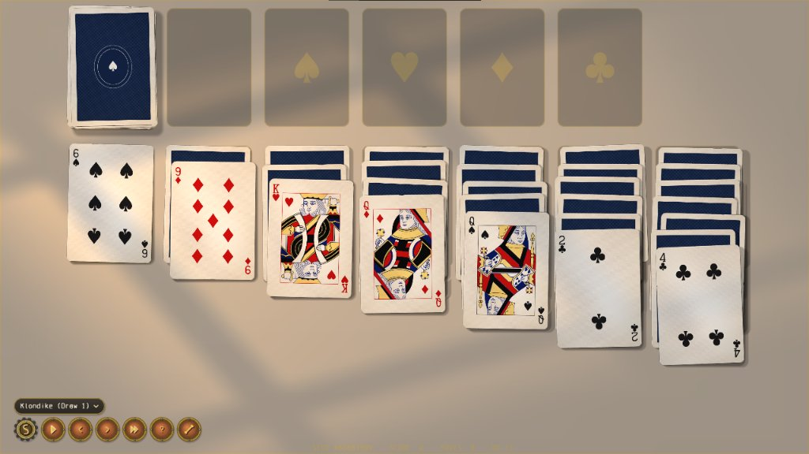
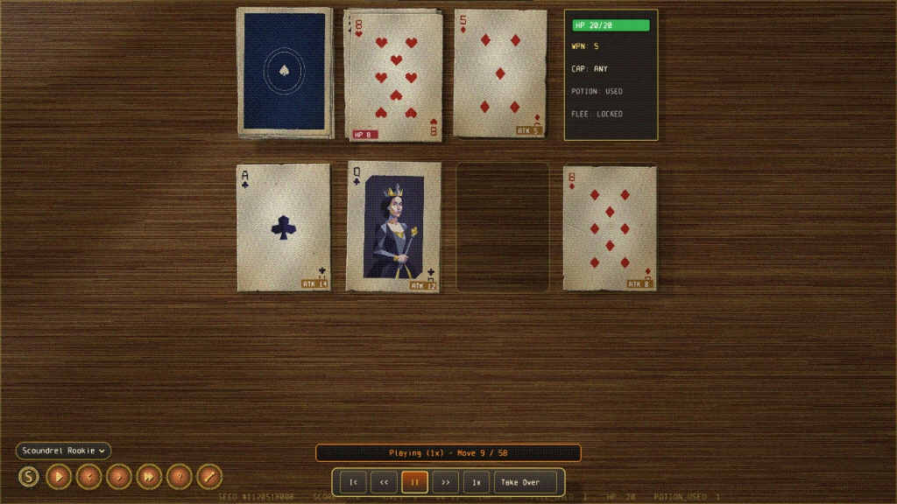
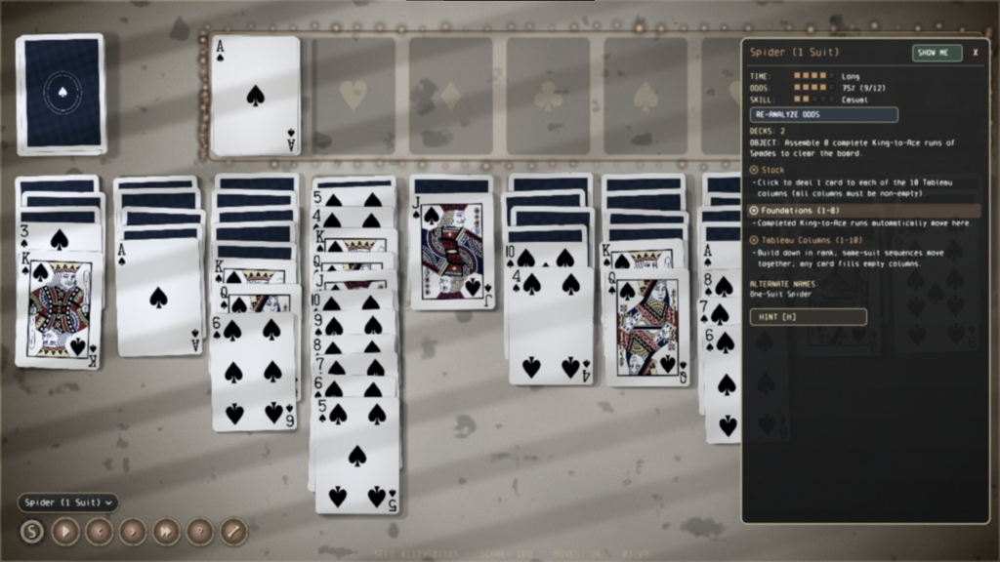

# SolEngine

> *"The Solitaire Engine. Bake your new Sol into existence with the power of Python-based scripting in Eatscript."*

[](https://solengine.org/)
[](https://github.com/maddestlabs/solengine)
[](file:///c:/git/solengine/LICENSE.md)
[](file:///c:/git/solengine/CMakeLists.txt)
[](file:///c:/git/solengine/src/gfx)
[](file:///c:/git/solengine/src/audio)



---

**SolEngine** is an ode to solitaire classics like *Hardwood Solitaire III* and the boundless monolith of *PySolFC*, remixed through modern **WebGPU** compute and fragment sorcery and a hybrid of procedural, vector and bitmap assets.

To minimize runtime, SolEngine leans heavily into procedural generation and desperately wants to draw everything in code, never relying on external assets. Alas, it doth protest.

Play instantly in your browser:  
👉 **[Launch SolEngine](https://solengine.org/)**

---

## The Core

### Scripting
SolEngine is built around **Eatscript**: a Pythonic scripting dialect where game logic, layout topology, and card movement are defined:
- **Classic Solitaries baked in:** *Klondike (Draw 1 & 3)*, *FreeCell*, *Spider (1, 2, & 4 Suits)*, *Yukon*.
- **Modernized Solitaires baked twice:** *Scoundrel*, *Scoundrel Rookie*.
- **Custom Variations & Bundles:** Craft your own game rules, tabletop shaders, decks, sound packs, ambience, post-FX, presets, and multi-game series via unified `.eats` scripts (`sol.define_game`, `sol.define_theme`, `sol.define_deck`, `sol.define_ambience`, `sol.define_sound_pack`, `sol.define_postfx`, `sol.define_preset`, `sol.define_series`). Share a single bundled `.eats` file or a multi-file GitHub Gist live on the web via `?gist=<GIST_ID>`. See [docs/eats-v2-revamp.md](docs/eats-v2-revamp.md) for the full format specification.

### Procedural API
Table backgrounds in SolEngine are forged in WebGPU fragment shaders while card faces and card backs can be designed with bitmaps, vector API, rendered via shader code or any combination of these.

### Features
- **One-Tap Smart Moves:** Hover or select any card or substack and single-click to immediately route it to Foundations or Tableau columns.
- **Auto-solver / Auto-play:** Toggle 'Solvable' mode on and wait just a moment for a guaranteed game. Use Auto-play to learn new games, move through history and easily finish games.
- **Soothing environments:** Realistic shadows and configurable environmental lighting coupled with synthesized audio depicting real world settings provide a relaxing backdrop for gameplay.
- **Extensible:** Create your own Eatscript code to extend the game to infinity minus realistic engine constraints.

| Custom Eatscript & Auto-Play (`Scoundrel Rookie`) | Interactive Help & Zone Highlighting (`Spider 1 Suit`) |
| :---: | :---: |
|  |  |

---

## Building

### 1. Desktop (Windows Native)

Compile and launch the native desktop application using PowerShell:

```powershell
# Build and immediately launch interactive desktop client
.\build.ps1

# Compile only without launching (safe for CI / agent environments)
.\build.ps1 -NoRun -NoLaunch

# Generate a headless snapshot preview of the table
.\build.ps1 -RenderPreview
```

### 2. Web (WebAssembly & WebGPU)

Compile into WebAssembly using Emscripten and host locally:

```powershell
# Compile WASM bundle and start local development server with COOP/COEP headers
.\build-web.ps1

# Compile only without launching the local web server
.\build-web.ps1 -NoServe

# Serve on a custom port
.\build-web.ps1 -Port 9000
```

---

## Table Controls & Keybindings

### Mouse, Touch & Gestures
| Action | Control |
| :--- | :--- |
| **Pick & Drag** | **Left Click + Drag** a card or face-up substack |
| **Smart Move** | **Single Tap / Click** (≤ 6 px drag) or **Right Click** on a card to auto-route it |
| **Deal Stock** | **Left Click** on the stock pile (or recycle waste) |
| **Open Settings** | **Right Click** on empty felt |
| **Felt Swipe Gestures** | **Swipe Left** = Undo, **Swipe Right** = Redo, **Swipe Up** = Auto-Play, **Swipe Down** = Hint |
| **Move Clockwork Toolbar** | **Drag** the Settings orb (`S`) to snap the toolbar to any corner or switch horizontal/vertical flow |
| **Play Options Menu** | **Right Click** or **Hold** the New Game (`▶`) button |
| **Toolbar Scale & Config** | **Tap** Resize (`⤢`) to cycle size (`Compact` / `Regular` / `Large`); **Right Click** or **Hold** to toggle toolbar buttons |
| **Scroll Lists & Help** | **Mouse Wheel** or **Drag** inside Game Browser, Settings, and Help & Rules |
| **Load Custom Script** | **Drag & Drop** a `.eats` file onto the window |

### Gameplay & Auto-Play Keys
| Action | Key |
| :--- | :--- |
| **New Deal** | **`N`** |
| **Guaranteed Solvable Deal** | **`Shift + N`** |
| **Restart Current Deal** | **`R`** |
| **Undo / Redo** | **`Z`** / **`Y`** (also **`Ctrl + Z`** / **`Ctrl + Y`**) |
| **Nether Sight (Hint)** | **`H`** (illuminates optimal move) |
| **Toggle Auto-Play** | **`A`**, **`Space`**, or **`P`** (starts or pauses/resumes Auto-Play) |
| **Auto-Play Step Back / Forward** | **`[`** / **`]`** |
| **Cycle Auto-Play Speed** | **`F`** |
| **Help & Rules Sidebar** | **`F1`** |
| **Close Overlay / Stop Auto-Play** | **`Esc`** |

### Menus, Quick Variants & Scene Hotkeys
| Action | Key |
| :--- | :--- |
| **Game Browser** | **`G`** (`Up`/`Down` to select, `Enter` to launch, `Backspace` to edit search, `Esc` to close) |
| **Settings Dialog** | **`O`** or **`M`** (`Tab` to switch tabs, `Enter` to apply, `Esc` to cancel) |
| **Deal Seed Dialog** | **`Shift + 3`** (`#`) (`Ctrl+C` / `Ctrl+V` to copy/paste seed, `Enter` to deal) |
| **Quick-Switch Variants** | **`1`** Klondike (Draw 1), **`2`** Klondike (Draw 3), **`3`** FreeCell, **`4`**–**`6`** Spider (1/2/4 Suits), **`7`** Golf |
| **Cycle Table Theme / Deck** | **`T`** (Table Theme) / **`D`** (Card Deck) |
| **Cycle Card Conditioning** | **`W`** (Wear), **`S`** (Card Stock), **`C`** (Corners), **`J`** (Organic Placement Jitter) |
| **Cycle Lighting Preset** | **`L`** |
| **Toggle Fullscreen** | **`F11`** or **`Alt + Enter`** |

---

## License

SolEngine is published under a **Split-License Model**:

* **Engine & Source Code:** Free Software released under the [GNU General Public License v3.0 (GPLv3)](file:///c:/git/solengine/LICENSE.md).
* **Art, Vector Decks, Foley Synthesis & Lore:** **All Rights Reserved** (or authorized non-commercial use only) to prevent unauthorized commercial asset-flipping and commercial cloning.
* **Trademarks:** *SolEngine*, is a proprietary trademarks of Maddest Labs.
