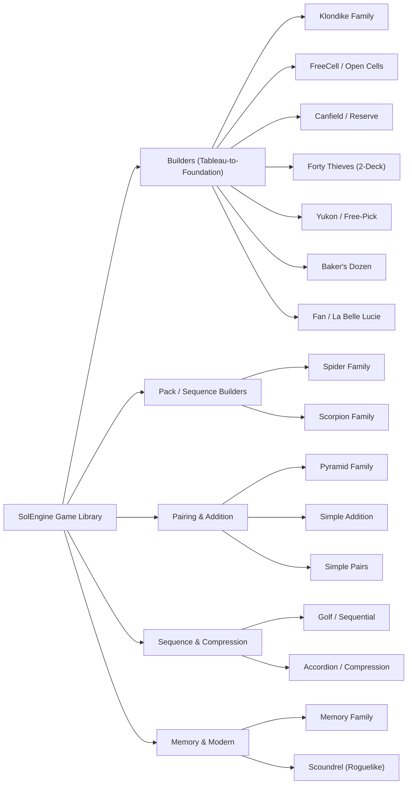

# SolEngine Game Library

This directory is the **canonical, research-backed documentation** for every solitaire game in SolEngine — covering verified histories, primary references, formal rules, rule-ambiguity resolutions, Eatscript implementation mappings, and solver considerations.

- **Master Concordance Catalog (JSON):** [catalog.json](catalog.json) *(canonical IDs, aliases, SolEngine status, and cross-engine links to Pretty Good Solitaire, Solitaire Forever II, BVS, PySolFC)*
- **Master Bibliography:** [REFERENCES.md](REFERENCES.md)
- **Game Spec Template:** [_TEMPLATE.md](_TEMPLATE.md)
- **Eatscript Format Spec:** [../eats-v2-revamp.md](../eats-v2-revamp.md)

---

## Status Legend

| Badge | Meaning |
| :---: | :--- |
| `documented` | Full research-backed spec with citations & solver analysis completed in `docs/games/` |
| `implemented` | Playable `.eats` definition exists in [games/](../../games/) (full doc pending) |
| `solver-tuned` | Documented, implemented, and heuristic/solver validated against benchmarks |
| `planned` | Researched or queued for future implementation |

---

## Family Taxonomy & Lineage Overview

SolEngine organizes games into **structural families** modeled after classic patience taxonomies (`[Parlett1979]`, `[MoreheadMottSmith1949]`), matching the consolidated `.eats` family files in [games/](../../games/).

---

## Complete Game Tree (53 Implemented across 22 Families)

### 1. Builders (Tableau-to-Foundation)

- **[Klondike Family](klondike/README.md)** — [games/klondike.eats](../../games/klondike.eats)
  - **[Klondike (Draw 1)](klondike/klondike.md)** (`klondike_draw_1`) — `documented` · `implemented`
  - **[Klondike (Draw 3)](klondike/klondike.md)** (`klondike_draw_3`) — `documented` · `implemented`
  - **[Easthaven](klondike/easthaven.md)** (`easthaven`) — `documented` · `implemented`
- **[FreeCell Family](freecell/README.md)** — [games/freecell.eats](../../games/freecell.eats)
  - **[Baker's Game](freecell/bakers-game.md)** (`bakers_game`) — `documented` · `implemented`
  - **[FreeCell](freecell/freecell.md)** (`freecell`) — `documented` · `implemented`
  - **[Eight Off](freecell/eight-off.md)** (`eight_off`) — `documented` · `implemented`
  - **[Seahaven Towers](freecell/seahaven-towers.md)** (`seahaven_towers`) — `documented` · `implemented`
  - **Penguin** (`penguin`) — `implemented`
- **[Yukon Family](yukon/README.md)** — [games/yukon.eats](../../games/yukon.eats)
  - **[Yukon](yukon/yukon.md)** (`yukon`) — `documented` · `implemented`
  - **[Russian Solitaire](yukon/russian-solitaire.md)** (`russian_solitaire`) — `documented` · `implemented`
- **Canfield Family** — [games/canfield.eats](../../games/canfield.eats)
  - **Canfield** (`canfield`) — `implemented`
  - **Rainbow** (`rainbow`) — `implemented`
- **Forty Thieves Family** — [games/forty_thieves.eats](../../games/forty_thieves.eats)
  - **Forty Thieves** (`forty_thieves`) — `implemented`
- **Baker's Dozen Family** — [games/bakers_dozen.eats](../../games/bakers_dozen.eats)
  - **Baker's Dozen** (`bakers_dozen`) — `implemented`
- **Fan Family** — [games/fan.eats](../../games/fan.eats)
  - **La Belle Lucie** (`la_belle_lucie`) — `implemented`
  - **The Fan** (`the_fan`) — `implemented`
  - **Cruel** (`cruel`) — `implemented`
- **Calculation Family** — [games/calculation.eats](../../games/calculation.eats)
  - **Calculation** (`calculation`) — `implemented`
- **Flower Garden Family** — [games/flower_garden.eats](../../games/flower_garden.eats)
  - **Flower Garden** (`flower_garden`) — `implemented`
- **Auld Lang Syne Family** — [games/auld_lang_syne.eats](../../games/auld_lang_syne.eats)
  - **Auld Lang Syne** (`auld_lang_syne`) — `implemented`

### 2. Pack / In-Tableau Sequence Builders

- **Spider Family** — [games/spider.eats](../../games/spider.eats)
  - **Spider (1 Suit)** (`spider_1_suit`) — `implemented`
  - **Spider (2 Suits)** (`spider_2_suits`) — `implemented`
  - **Spider (4 Suits)** (`spider_4_suits`) — `implemented`
  - **Spiderette** (`spiderette`) — `implemented`
- **Scorpion Family** — [games/scorpion.eats](../../games/scorpion.eats)
  - **Scorpion** (`scorpion`) — `implemented`
  - **Wasp** (`wasp`) — `implemented`

### 3. Pairing & Addition

- **Pyramid Family** — [games/pyramid.eats](../../games/pyramid.eats)
  - **Pyramid** (`pyramid`) — `implemented`
  - **Giza** (`giza`) — `implemented`
- **Simple Addition Family** — [games/simple_addition.eats](../../games/simple_addition.eats)
  - **Block Ten** (`block_ten`) — `implemented`
  - **Elevens** (`elevens`) — `implemented`
  - **Thirteens** (`thirteens`) — `implemented`
  - **Fourteens** (`fourteens`) — `implemented`
- **Simple Pairs Family** — [games/simple_pairs.eats](../../games/simple_pairs.eats)
  - **Simple Pairs** (`simple_pairs`) — `implemented`
  - **Monte Carlo** (`monte_carlo`) — `implemented`
  - **Nestor** (`nestor`) — `implemented`
  - **Doublets** (`doublets`) — `implemented`
- **Aces Up Family** — [games/aces_up.eats](../../games/aces_up.eats)
  - **Aces Up** (`aces_up`) — `implemented`

### 4. Sequential & Compression

- **Golf Family** — [games/golf.eats](../../games/golf.eats)
  - **Golf** (`golf`) — `implemented`
  - **TriPeaks** (`tri_peaks`) — `implemented`
  - **Clockwork Dial** (`clockwork_dial`) — `implemented`
  - **Black Hole** (`black_hole`) — `implemented`
- **Accordion Family** — [games/accordion.eats](../../games/accordion.eats)
  - **Accordion** (`accordion`) — `implemented`
  - **Accordion (32-Card)** (`accordion_32`) — `implemented`
  - **Betrothal** (`betrothal`) — `implemented`
- **Gaps Family** — [games/gaps.eats](../../games/gaps.eats)
  - **Gaps** (`gaps`) — `implemented`

### 5. Memory & Modern Solitaires

- **Memory Family** — [games/memory.eats](../../games/memory.eats)
  - **Memory** (`memory`) — `implemented`
  - **Memory (4x4)** (`memory_4x4`) — `implemented`
  - **Memory (13x4)** (`memory_13x4`) — `implemented`
  - **Memory (Figure-8)** (`memory_figure8`) — `implemented`
  - **Clockwork Memory** (`clockwork_memory`) — `implemented`
- **Scoundrel Family** — [games/scoundrel.eats](../../games/scoundrel.eats)
  - **Scoundrel** (`scoundrel`) — `implemented`
  - **Scoundrel in Training** (`scoundrel_in_training`) — `implemented`
- **Poker Squares Family** — [games/poker_squares.eats](../../games/poker_squares.eats)
  - **Poker Squares** (`poker_squares`) — `implemented`

---

## Doc-First Workflow for Expanding the Library

When adding a new game (or backfilling an existing one):

1. **Verify & Cite:** Research the game's print history, rule variants, and solver literature; add any new sources to [REFERENCES.md](REFERENCES.md).
2. **Draft the Spec:** Copy [_TEMPLATE.md](_TEMPLATE.md) into `docs/games/<family>/<game>.md` and fill out all sections, explicitly documenting rule conventions and solver considerations.
3. **Implement / Tune in Eatscript:** Build or refine the game in `games/<family>.eats` and align its `eval_heuristic` with the documented solver profile.
4. **Update the Tree:** Add or update the game's entry and status badge in both `docs/games/<family>/README.md` and this index.
