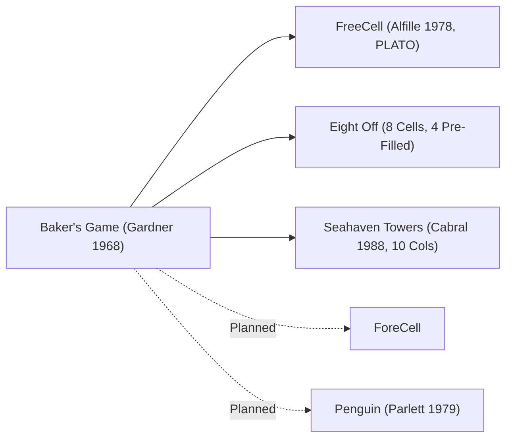

# FreeCell Family

The **FreeCell family** is the premier **open-information, pure-skill** solitaire lineage: all 52 cards are dealt face-up from the start, and temporary single-card holding spaces (**FreeCells**) replace the traditional stock and waste piles `[Gardner1968]`, `[KellerFreeCell]`, `[Parlett1979]`.

- **Eatscript Source:** [games/freecell.eats](../../../games/freecell.eats)
- **Parent Index:** [Game Library](../README.md)

---

## Family Lineage

---

## Variant Comparison

| Variant | ID | FreeCells (Pre-Filled) | Tableau Columns | Build Rule | Empty Column | Solvability `[BlakeGent2019]` | Status | Doc | Play |
| :--- | :--- | :---: | :---: | :--- | :--- | :---: | :---: | :--- | :---: |
| **Baker's Game** | `bakers_game` | 4 (0) | 8 (`7×4, 6×4`) | Same suit | Any card | ~75.05% | `documented` · `implemented` | [bakers-game.md](bakers-game.md) | [Play](https://solitaireengine.org/?game=bakers_game) |
| **FreeCell** | `freecell` | 4 (0) | 8 (`7×4, 6×4`) | Alternating color | Any card | ~99.999% | `documented` · `implemented` | [freecell.md](freecell.md) | [Play](https://solitaireengine.org/?game=freecell) |
| **Eight Off** | `eight_off` | 8 (4) | 8 (`6×8`) | Same suit | Kings only | ~99.88% | `documented` · `implemented` | [eight-off.md](eight-off.md) | [Play](https://solitaireengine.org/?game=eight_off) |
| **Seahaven Towers** | `seahaven_towers` | 4 (2) | 10 (`5×10`) | Same suit | Kings only | ~89.33% | `documented` · `implemented` | [seahaven-towers.md](seahaven-towers.md) | [Play](https://solitaireengine.org/?game=seahaven_towers) |

---

## Shared Family Architecture

In [games/freecell.eats](../../../games/freecell.eats), all four variants are driven by a single parameterized rule engine:
- `fc_eval(fc_end, f_start, f_end, t_start, t_end, same_suit, fc_wt, empty_wt, seq_wt)` ([L12-L40](../../../games/freecell.eats#L12-L40)) — scores foundation cards (`+150`), empty free cells, empty tableau columns, and in-order adjacent tableau pairs.
- `fc_max_supermove(fc_end, t_start, t_end, exclude_z)` ([L42-L55](../../../games/freecell.eats#L42-L55)) — computes supermove capacity `(empty_fc + 1) * 2^(empty_non_target_tableaus)`.
- `fc_can_pick(...)` ([L57-L76](../../../games/freecell.eats#L57-L76)) — validates free-cell picks and ordered tableau runs within supermove capacity.
- `fc_can_drop(...)` ([L78-L109](../../../games/freecell.eats#L78-L109)) — enforces single-card cell drops, Ace-to-King suit foundations, supermove limits excluding the destination column, and `same_suit` / `king_only` tableau rules.
- `fc_status(f_start, f_end)` ([L111-L119](../../../games/freecell.eats#L111-L119)) — victory check at 52 foundation cards.
