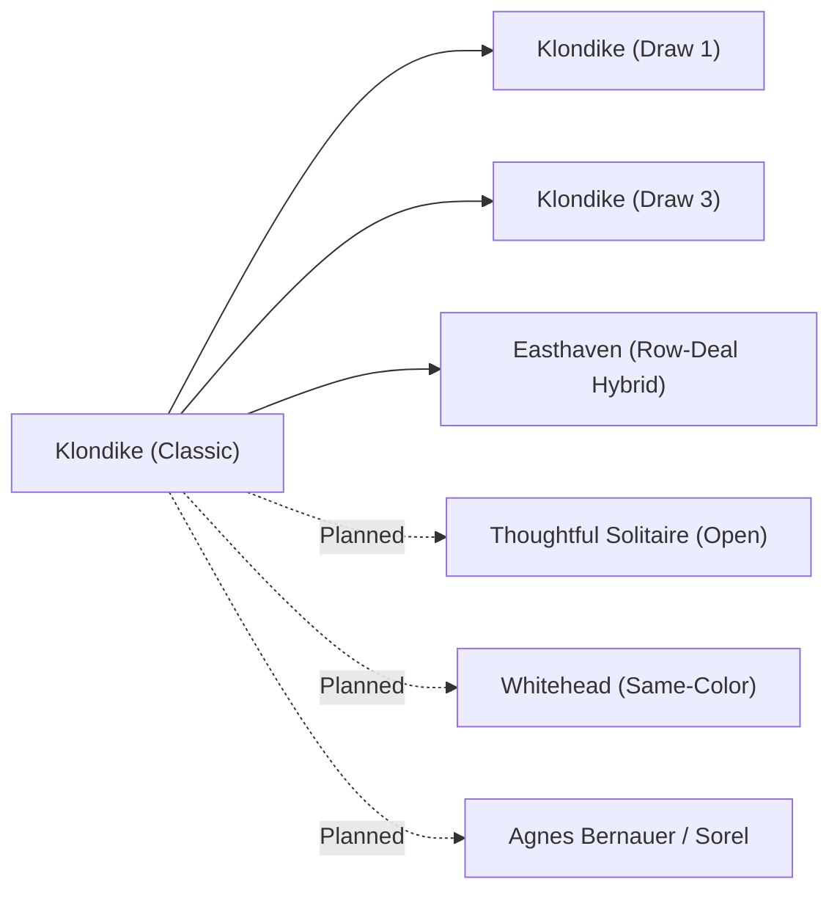

# Klondike Family

The **Klondike family** is the archetypal single-deck tableau-builder lineage: cards are built downward in alternating colors across 7 tableau columns (partially face-down) while 4 foundations build upward by suit from Ace to King `[Parlett1979]`, `[MoreheadMottSmith1949]`.

- **Eatscript Source:** [games/klondike.eats](../../../games/klondike.eats)
- **Parent Index:** [Game Library](../README.md)

---

## Family Lineage

---

## Variant Comparison

| Variant | ID | Deal Layout | Stock Mode | Redeals | Empty Column | Status | Doc | Play |
| :--- | :--- | :--- | :--- | :--- | :--- | :--- | :--- | :---: |
| **Klondike (Draw 1)** | `klondike_draw_1` | 1–7 triangle (28 cards) | 1 to Waste | Unlimited | Kings only | `documented` · `implemented` | [klondike.md](klondike.md) | [Play](https://solitaireengine.org/?game=klondike_draw_1) |
| **Klondike (Draw 3)** | `klondike_draw_3` | 1–7 triangle (28 cards) | 3 to Waste | Unlimited | Kings only | `documented` · `implemented` | [klondike.md](klondike.md) | [Play](https://solitaireengine.org/?game=klondike_draw_3) |
| **Easthaven** | `easthaven` | 7 columns × 3 (21 cards) | 1 to each column | None (0) | Kings only | `documented` · `implemented` | [easthaven.md](easthaven.md) | [Play](https://solitaireengine.org/?game=easthaven) |

---

## Shared Family Architecture

In [games/klondike.eats](../../../games/klondike.eats), all three implemented variants share:
- `klondike_eval()` — baseline foundation + hidden-card heuristic
- `klondike_can_drop(from_z, i, to_z)` — alternating-color tableau drop + suit-up foundation drop
- `klondike_on_turn_end()` — automatic reveal of newly exposed face-down tableau cards
- `klondike_status()` — victory check at 52 foundation cards

Variants override only what diverges: `on_stock_click` (`k1_stock`, `k3_stock`, `easthaven_stock`) and `can_pick` (`klondike_can_pick` vs. `easthaven_can_pick`, which enforces ordered-run verification).
