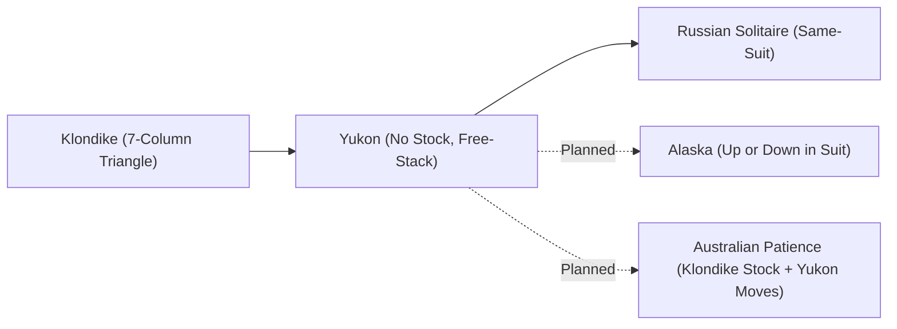

# Yukon Family

The **Yukon family** removes Klondike's stock and waste piles entirely — dealing all 52 cards onto 7 tableau columns — and introduces **free-stack movement**: any face-up card may be picked up along with *all* cards resting on top of it, regardless of whether those overlying cards form an ordered sequence `[MoreheadMottSmith1949]`, `[Parlett1979]`.

- **Eatscript Source:** [games/yukon.eats](../../../games/yukon.eats)
- **Parent Index:** [Game Library](../README.md)

---

## Family Lineage

---

## Variant Comparison

| Variant | ID | Deal Layout | Build Rule | Empty Column | Move Group | Status | Doc | Play |
| :--- | :--- | :--- | :--- | :--- | :--- | :--- | :--- | :---: |
| **Yukon** | `yukon` | `[1, 6, 7, 8, 9, 10, 11]` (21 face-down, 31 face-up) | Alternating color | Kings only | Any face-up stack | `documented` · `implemented` | [yukon.md](yukon.md) | [Play](https://solitaireengine.org/?game=yukon) |
| **Russian Solitaire** | `russian_solitaire` | `[1, 6, 7, 8, 9, 10, 11]` (21 face-down, 31 face-up) | Same suit | Kings only | Any face-up stack | `documented` · `implemented` | [russian-solitaire.md](russian-solitaire.md) | [Play](https://solitaireengine.org/?game=russian_solitaire) |

---

## Shared Family Architecture

In [games/yukon.eats](../../../games/yukon.eats), both variants share the exact same layout, pick rule, turn-end reveal, victory check, and heuristic:
- `yukon_eval()` ([L10-L32](../../../games/yukon.eats#L10-L32)) — foundation progress (`+500`), empty columns (`+150`), hidden-card penalty (`-200`), and a buried-depth penalty (`-15` per face-up card sitting on top of face-down cards).
- `yukon_can_pick(z, i)` ([L34-L38](../../../games/yukon.eats#L34-L38)) — permits picking **any** face-up card in tableau columns `4..10` (no sequence check on cards above `i`).
- `yukon_can_drop(same_suit, from_z, i, to_z)` ([L40-L64](../../../games/yukon.eats#L40-L64)) — parameterized by `same_suit` (`False` for Yukon, `True` for Russian Solitaire).
- `yukon_on_turn_end()` & `yukon_status()` ([L66-L79](../../../games/yukon.eats#L66-L79)) — flips exposed face-down cards and checks for 52 foundation cards.
